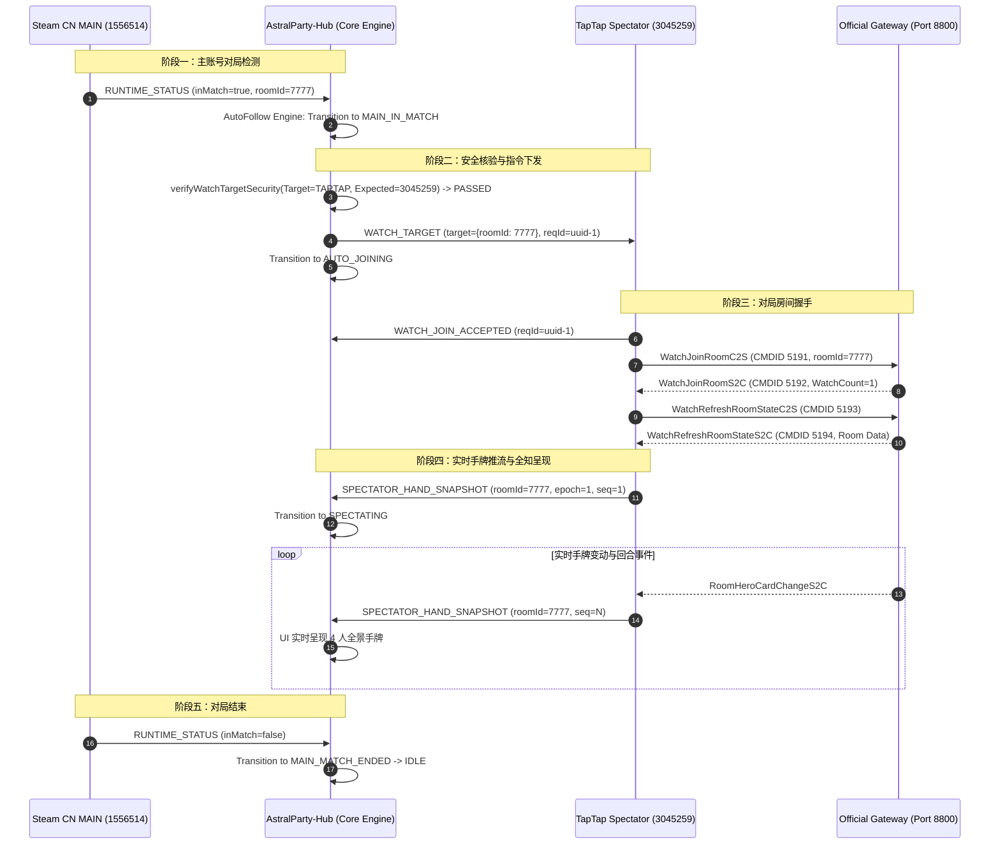

# Project XingShu — Auto-Follow Local Control Protocol Specification
**Protocol Version:** `V0.1-WATCH`  
**Phase:** HS4-P1.6 — State Machine & Regression Specialist Report  
**Transport:** Loopback TCP (`127.0.0.1:25890`), JSON Framed Lines (`\n` terminated, 64KB max)  
**Security Level:** `STRICT CONFINEMENT / TAPTAP_ONLY`

---

## 1. Protocol Architecture & Overview

The **Auto-Follow Local Control Protocol** enables AstralParty-Hub to instruct the dedicated spectator client running APX Runtime (**TapTap USER_SPECTATOR**, PlayerId `3045259`) to join a specific match room.

```
+---------------------------------------------------------------------------------+
|                                AstralParty-Hub                                  |
|   - Multi-Client Runtime Session Manager                                        |
|   - Auto-Follow Finite State Machine (11 States)                               |
|   - Strict Security Guard (Blocks Steam CN, Enforces TapTap 3045259)           |
+---------------------------------------------------------------------------------+
          │                                               ▲
          │ WATCH_TARGET (Outbound)                       │ Inbound Responses:
          │ - target (room/watch primitive)               │ - WATCH_JOIN_ACCEPTED
          │ - requestId                                   │ - WATCH_JOIN_REJECTED
          │ - timestamp                                   │ - WATCH_JOIN_TIMEOUT
          │ - targetPlatform: "TAPTAP"                    │ - WATCH_ALREADY_JOINED
          │ - expectedSpectatorPlayerId: 3045259          │ - WATCH_TARGET_INVALID
          ▼                                               │
+---------------------------------------------------------------------------------+
|                       APX Runtime (TapTap Spectator Client)                     |
|   - Loopback TCP Transport (`127.0.0.1:25890`)                                  |
|   - GameLogic.WatchLogic Hook (WatchJoinRoomC2S / WatchRefreshRoomStateC2S)     |
|   - SpectatorStateStore & Hand Snapshot Reducer                                 |
+---------------------------------------------------------------------------------+
```

---

## 2. Strict Security Boundary & Non-Routing Invariant

> [!CAUTION]
> **STRICT SECURITY INVARIANT (HS4-P1.6)**:  
> AstralParty-Hub may send `WATCH_TARGET` **ONLY** to verified `TAPTAP` RuntimeSession matching bound `USER_SPECTATOR` (PlayerId `3045259`).  
> **NEVER** route `WATCH_TARGET` to the user's primary `STEAM_CN` MAIN gameplay runtime (PlayerId `1556514`).

### Enforcement Layers:
1. **Rust Backend (`server.rs`):**
   ```rust
   if session.platform_id != "TAPTAP" {
       let err = format!(
           "SECURITY_VIOLATION: Attempted to route WATCH_TARGET to platform '{}'. Hub may send WATCH_TARGET ONLY to verified TAPTAP RuntimeSession, NEVER to Steam MAIN!",
           session.platform_id
       );
       return Err(err);
   }
   if let Some(pid) = session.player_id {
       if pid > 0 && pid as u64 != expected_spectator_player_id {
           return Err(format!(
               "SECURITY_VIOLATION: Runtime player ID {} does not match bound USER_SPECTATOR {}!",
               pid, expected_spectator_player_id
           ));
       }
   }
   ```
2. **TypeScript Service (`autoFollowStateMachine.ts`):**
   `verifyWatchTargetSecurity()` strictly validates target platform and player ID before initiating any IPC call.
3. **UI Guard (`AutoFollowStatusPanel.tsx`):**
   Top-level card for Steam CN displays `Read-only battle feed`, preventing any join action binding.

---

## 3. Message Format Contracts

All messages adhere to standard XingShu Bridge JSON Envelope V0.1:

```json
{
  "protocolVersion": "0.1",
  "messageType": "<MESSAGE_TYPE>",
  "requestId": "<UUIDv4>",
  "timestamp": 1729267200000,
  "payload": { ... }
}
```

### 3.1. Outbound Command: `WATCH_TARGET`

- **Sender:** AstralParty-Hub
- **Receiver:** TapTap Spectator Runtime
- **Message Type:** `"WATCH_TARGET"`

#### Field Contract:
| Field | Type | Required | Description |
|---|---|---|---|
| `target` | `Object` / `String` / `Number` | Yes | Room/watch primitive. Contains `roomId` (e.g. `7777`), optional `watchCode` (e.g. `"ABCDEF"`), and optional `roomServerId`. |
| `requestId` | `String` (UUID v4) | Yes | Unique correlation ID for tracking request lifecycle. |
| `timestamp` | `Integer` (i64 ms) | Yes | Client dispatch timestamp (Unix epoch in milliseconds). |
| `targetPlatform` | `String` | Yes | Must be strictly `"TAPTAP"`. |
| `expectedSpectatorPlayerId` | `Integer` (u64) | Yes | Bound spectator player ID (`3045259`). |

#### Example JSON:
```json
{
  "protocolVersion": "0.1",
  "messageType": "WATCH_TARGET",
  "requestId": "550e8400-e29b-41d4-a716-446655440000",
  "timestamp": 1729267201500,
  "payload": {
    "target": {
      "roomId": 7777,
      "watchCode": "ABCDEF",
      "mapId": 82016
    },
    "requestId": "550e8400-e29b-41d4-a716-446655440000",
    "timestamp": 1729267201500,
    "targetPlatform": "TAPTAP",
    "expectedSpectatorPlayerId": 3045259
  }
}
```

---

### 3.2. Inbound Responses (Runtime -> Hub)

The APX Runtime responds with one of 5 canonical response types matching `requestId`:

#### 1. `WATCH_JOIN_ACCEPTED`
- **Meaning:** Runtime successfully received `WATCH_TARGET`, validated lobby state, and dispatched `WatchJoinRoomC2S` to the game gateway.
- **Payload:**
  ```json
  {
    "status": "WATCH_JOIN_ACCEPTED",
    "requestId": "550e8400-e29b-41d4-a716-446655440000",
    "target": { "roomId": 7777, "watchCode": "ABCDEF" },
    "reason": "RUNTIME_ACCEPTED",
    "timestamp": 1729267201620
  }
  ```

#### 2. `WATCH_JOIN_REJECTED`
- **Meaning:** Gateway or logic server rejected spectator join. Typical reasons:
  - `ROOM_AUDIENCE_NUMBLIMIT` (audience count >= 10)
  - `ROOM_NOT_FOUND` / `ROOM_DISSOLVED`
  - `PERMISSION_DENIED`
- **Payload:**
  ```json
  {
    "status": "WATCH_JOIN_REJECTED",
    "requestId": "550e8400-e29b-41d4-a716-446655440000",
    "target": { "roomId": 7777 },
    "reason": "ROOM_AUDIENCE_NUMBLIMIT_REACHED",
    "timestamp": 1729267201750
  }
  ```

#### 3. `WATCH_JOIN_TIMEOUT`
- **Meaning:** Watch join request sent to official game server, but no response (`WatchJoinRoomS2C`) was received within 5000ms.
- **Payload:**
  ```json
  {
    "status": "WATCH_JOIN_TIMEOUT",
    "requestId": "550e8400-e29b-41d4-a716-446655440000",
    "reason": "GATEWAY_RESPONSE_TIMEOUT",
    "timestamp": 1729267206500
  }
  ```

#### 4. `WATCH_ALREADY_JOINED`
- **Meaning:** Spectator client is already present in the target match room. Zero redundant joins performed.
- **Payload:**
  ```json
  {
    "status": "WATCH_ALREADY_JOINED",
    "requestId": "550e8400-e29b-41d4-a716-446655440000",
    "target": { "roomId": 7777 },
    "timestamp": 1729267201550
  }
  ```

#### 5. `WATCH_TARGET_INVALID`
- **Meaning:** Malformed target specification (e.g. `roomId <= 0` and `watchCode` empty).
- **Payload:**
  ```json
  {
    "status": "WATCH_TARGET_INVALID",
    "requestId": "550e8400-e29b-41d4-a716-446655440000",
    "reason": "TARGET_EMPTY_OR_MALFORMED",
    "timestamp": 1729267201520
  }
  ```

---

## 4. Protocol Flow Sequence Diagram



---

## 5. Implementation File Index

| Component | Language | File Path | Responsibility |
|---|---|---|---|
| **Protocol Constants & Payloads** | Rust | [`AstralParty-Hub/src-tauri/src/xing_shu/bridge/protocol.rs`](file:///E:/%E5%B7%A5%E4%BD%9C%E6%B5%81/%E6%98%9F%E5%BC%95%E6%93%8E%E6%8F%92%E4%BB%B6/AstralParty-Hub/src-tauri/src/xing_shu/bridge/protocol.rs) | Defines `WATCH_TARGET`, response types, and serialization structs. |
| **Server Security & Dispatch** | Rust | [`AstralParty-Hub/src-tauri/src/xing_shu/bridge/server.rs`](file:///E:/%E5%B7%A5%E4%BD%9C%E6%B5%81/%E6%98%9F%E5%BC%95%E6%93%8E%E6%8F%92%E4%BB%B6/AstralParty-Hub/src-tauri/src/xing_shu/bridge/server.rs) | Enforces non-Steam routing, sends envelopes, dispatches responses. |
| **Tauri IPC Command** | Rust | [`AstralParty-Hub/src-tauri/src/commands/xingshu_commands.rs`](file:///E:/%E5%B7%A5%E4%BD%9C%E6%B5%81/%E6%98%9F%E5%BC%95%E6%93%8E%E6%8F%92%E4%BB%B6/AstralParty-Hub/src-tauri/src/commands/xingshu_commands.rs) | Exposes `send_watch_target` to frontend. |
| **State Machine Engine** | TypeScript | [`AstralParty-Hub/src/services/autoFollowStateMachine.ts`](file:///E:/%E5%B7%A5%E4%BD%9C%E6%B5%81/%E6%98%9F%E5%BC%95%E6%93%8E%E6%8F%92%E4%BB%B6/AstralParty-Hub/src/services/autoFollowStateMachine.ts) | Pure FSM evaluating 11 states, security checks, and error recovery. |
| **Integration Service** | TypeScript | [`AstralParty-Hub/src/services/autoFollowService.ts`](file:///E:/%E5%B7%A5%E4%BD%9C%E6%B5%81/%E6%98%9F%E5%BC%95%E6%93%8E%E6%8F%92%E4%BB%B6/AstralParty-Hub/src/services/autoFollowService.ts) | Binds Tauri IPC, Session Resolver, and AutoFollowStateMachine. |
| **UI Presentation** | TSX | [`AstralParty-Hub/src/pages/spectator/components/AutoFollowStatusPanel.tsx`](file:///E:/%E5%B7%A5%E4%BD%9C%E6%B5%81/%E6%98%9F%E5%BC%95%E6%93%8E%E6%8F%92%E4%BB%B6/AstralParty-Hub/src/pages/spectator/components/AutoFollowStatusPanel.tsx) | Renders dual-client cards, progression pipeline, error fallback, diagnostics. |
| **C# Protocol & Client** | C# | [`APX-Dev/src/APX.hooks/XingShu/Bridge/BridgeProtocol.cs`](file:///E:/%E5%B7%A5%E4%BD%9C%E6%B5%81/%E6%98%9F%E5%BC%95%E6%93%8E%E6%8F%92%E4%BB%B6/APX-Dev/src/APX.hooks/XingShu/Bridge/BridgeProtocol.cs) | C# runtime message constants and incoming `WATCH_TARGET` handler. |
| **Regression Test Suite** | TypeScript | [`AstralParty-Hub/src/test/auto_follow_state_machine.test.ts`](file:///E:/%E5%B7%A5%E4%BD%9C%E6%B5%81/%E6%98%9F%E5%BC%95%E6%93%8E%E6%8F%92%E4%BB%B6/AstralParty-Hub/src/test/auto_follow_state_machine.test.ts) | 20 automated regression tests verifying all states and security invariants. |
