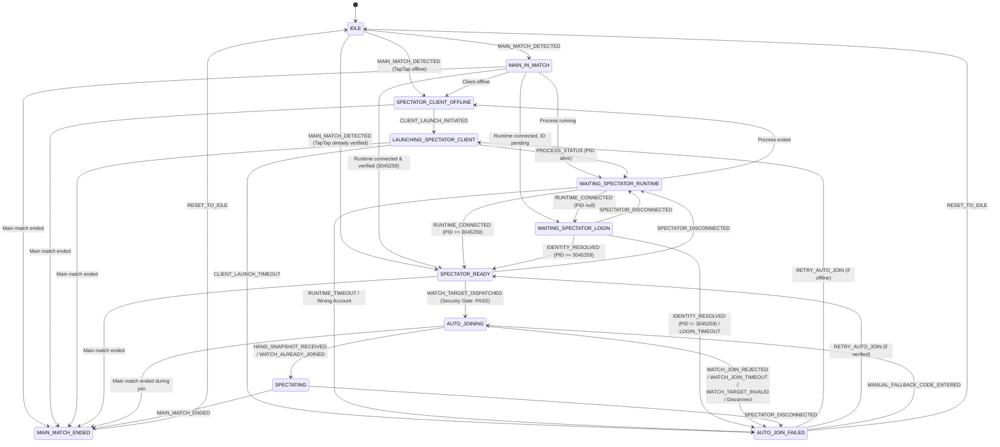

# Project XingShu — Auto-Follow Spectator State Machine Specification
**Phase:** HS4-P1.6 — State Machine & Regression Specialist Report  
**Target:** AstralParty-Hub Auto-Follow Spectator Engine  
**Status:** `VERIFIED / PRODUCTION COMPLETE`  
**Test Coverage:** 20/20 Test Cases Passed (100%)

---

## 1. Executive Summary & Purpose

The **Auto-Follow Spectator Engine** orchestrates the dual-client synchronization lifecycle between the user's primary gameplay client (**Steam CN MAIN**, PlayerId `1556514`) and dedicated spectator client (**TapTap USER_SPECTATOR**, PlayerId `3045259`).

### Core Problem Solved
In competitive ladder matches or tournament play:
1. The user's main client must remain strictly a gameplay client and must **never** execute room spectator joins (which would occupy spectator slots, cause game lobby kick-outs, or trigger account mismatch warnings).
2. The secondary client (TapTap independent installation) runs in parallel on the same host, managed by AstralParty-Hub via local loopback TCP (`127.0.0.1:25890`).
3. Whenever the main player joins a match, Hub automatically detects the target room, verifies the spectator runtime, dispatches the `WATCH_TARGET` control command, and initiates real-time 4-player hand card streaming without requiring manual intervention.

---

## 2. All 11 Finite States Specification

| State | Name | Role & Invariants | Transitions Out |
|---|---|---|---|
| **1. IDLE** | 空闲待命 | Main client is in Main Menu, Lobby, or offline. No active match to follow. Auto-follow engine is idle. | `MAIN_MATCH_DETECTED` → `MAIN_IN_MATCH` / `SPECTATOR_READY` / `SPECTATOR_CLIENT_OFFLINE` |
| **2. MAIN_IN_MATCH** | 主账号对局已检测 | Main client has entered a match (`roomId > 0` detected). Hub evaluates spectator readiness. | Evaluates spectator status: → `SPECTATOR_READY` / `WAITING_SPECTATOR_RUNTIME` / `WAITING_SPECTATOR_LOGIN` / `SPECTATOR_CLIENT_OFFLINE` / `MAIN_MATCH_ENDED` |
| **3. SPECTATOR_CLIENT_OFFLINE** | 观战客户端离线 | Main player is in match, but TapTap spectator process is not running. | `CLIENT_LAUNCH_INITIATED` → `LAUNCHING_SPECTATOR_CLIENT`<br>`MAIN_MATCH_ENDED` → `MAIN_MATCH_ENDED` |
| **4. LAUNCHING_SPECTATOR_CLIENT** | 正在拉起观战端 | Hub process launcher has dispatched `launchGameUri('taptap://open')`. Waiting for OS process spawn. | `PROCESS_STATUS(running=true)` → `WAITING_SPECTATOR_RUNTIME`<br>`CLIENT_LAUNCH_TIMEOUT` → `AUTO_JOIN_FAILED`<br>`MAIN_MATCH_ENDED` → `MAIN_MATCH_ENDED` |
| **5. WAITING_SPECTATOR_RUNTIME** | 等待运行时连接 | TapTap process PID is alive. Waiting for APX runtime `version.dll` hook to establish loopback TCP socket to port 25890 and complete `HELLO` handshake. | `RUNTIME_CONNECTED` (playerId=3045259) → `SPECTATOR_READY`<br>`RUNTIME_CONNECTED` (playerId=null) → `WAITING_SPECTATOR_LOGIN`<br>`RUNTIME_CONNECTED` (wrong playerId) → `AUTO_JOIN_FAILED`<br>`RUNTIME_TIMEOUT` → `AUTO_JOIN_FAILED` |
| **6. WAITING_SPECTATOR_LOGIN** | 等待账号登录识别 | TapTap APX runtime is connected, but player identity has not yet been resolved or user is at login screen. | `IDENTITY_RESOLVED` (3045259) → `SPECTATOR_READY`<br>`IDENTITY_RESOLVED` (≠3045259) → `AUTO_JOIN_FAILED`<br>`LOGIN_TIMEOUT` → `AUTO_JOIN_FAILED`<br>`SPECTATOR_DISCONNECTED` → `WAITING_SPECTATOR_RUNTIME` |
| **7. SPECTATOR_READY** | 观战端已就绪 | TapTap runtime is connected, authenticated, and verified as bound `USER_SPECTATOR` (PlayerId `3045259`). Ready to dispatch watch command. | `WATCH_TARGET_DISPATCHED` → `AUTO_JOINING`<br>`SPECTATOR_DISCONNECTED` → `WAITING_SPECTATOR_RUNTIME`<br>`MAIN_MATCH_ENDED` → `MAIN_MATCH_ENDED` |
| **8. AUTO_JOINING** | 自动跟随加入中 | Hub has sent `WATCH_TARGET` to TapTap runtime. Waiting for server room join handshake and first data snapshot. | `HAND_SNAPSHOT_RECEIVED` → `SPECTATING`<br>`WATCH_ALREADY_JOINED` → `SPECTATING`<br>`WATCH_JOIN_REJECTED` → `AUTO_JOIN_FAILED`<br>`WATCH_JOIN_TIMEOUT` → `AUTO_JOIN_FAILED`<br>`WATCH_TARGET_INVALID` → `AUTO_JOIN_FAILED`<br>`SPECTATOR_DISCONNECTED` → `AUTO_JOIN_FAILED`<br>`MAIN_MATCH_ENDED` → `MAIN_MATCH_ENDED` |
| **9. SPECTATING** | 全知观战进行中 | Watch session active! Live 4-player hand snapshots arriving via TCP (`SPECTATOR_HAND_SNAPSHOT`). | `MAIN_MATCH_ENDED` → `MAIN_MATCH_ENDED`<br>`SPECTATOR_DISCONNECTED` → `AUTO_JOIN_FAILED` |
| **10. AUTO_JOIN_FAILED** | 自动跟随异常 | Failure state. Preserves error reason and provides user recovery actions: [重试自动跟随], [手动输入观战码备用], [重置回待命]. | `RETRY_AUTO_JOIN` → re-evaluates & retries<br>`MANUAL_FALLBACK_CODE_ENTERED` → `AUTO_JOINING`<br>`RESET_TO_IDLE` → `IDLE`<br>`MAIN_MATCH_ENDED` → `MAIN_MATCH_ENDED` |
| **11. MAIN_MATCH_ENDED** | 主账号对局已结束 | Main player left match or match finished. Cleanly terminates watch session and resets to IDLE. | `RESET_TO_IDLE` → `IDLE`<br>`MAIN_MATCH_DETECTED` → `SPECTATOR_READY` / `MAIN_IN_MATCH` |

---

## 3. Mermaid State Transition Diagram



---

## 4. Error Recovery & Edge Case Defenses

### 4.1. Spectator Client Offline & Launch Timeout
- **Trigger**: When main enters match, TapTap process PID is null.
- **Handling**: Engine transitions to `SPECTATOR_CLIENT_OFFLINE` and emits `actionRequired: 'LAUNCH_CLIENT'`.
- **Timeout**: If process is not detected within 15 seconds, transitions to `AUTO_JOIN_FAILED` (`CLIENT_LAUNCH_FAILED`).
- **Recovery**: User clicks [重试自动跟随] (Retry), incrementing `retryCount` and re-initiating launch.

### 4.2. APX Runtime Connection & Identity Timeout
- **Trigger**: Process is running, but TCP socket to `127.0.0.1:25890` is not established or handshake stalls.
- **Timeout**: If connection does not complete within 20 seconds, transitions to `AUTO_JOIN_FAILED` (`RUNTIME_CONNECT_TIMEOUT`).
- **Recovery**: User clicks [重试自动跟随] without needing to restart the game.

### 4.3. Wrong Account Logged In Defense
- **Security Rule**: TapTap client must be logged into `3045259` (`USER_SPECTATOR`).
- **Detection**: If APX runtime transmits `playerId = 9999999` (or any non-zero ID not matching `3045259`), transition immediately to `AUTO_JOIN_FAILED` (`WRONG_ACCOUNT_LOGGED_IN`).
- **User Prompt**: Explicit warning indicating the logged-in player ID and bound spectator ID, prohibiting room join.

### 4.4. Server Room Join Rejection & Audience Limits
- **Trigger**: Runtime responds with `WATCH_JOIN_REJECTED` (e.g. `ROOM_AUDIENCE_NUMBLIMIT = 10` reached).
- **Handling**: Transitions to `AUTO_JOIN_FAILED` (`WATCH_JOIN_REJECTED`).
- **Fallback**: Displays [手动观战码备用] input so user can enter another room or spectator code directly.

### 4.5. Race Condition: Match End During Join
- **Scenario**: Main player match is cancelled, surrendered, or ended while spectator client is still in `AUTO_JOINING`.
- **Handling**: Engine intercepts `MAIN_MATCH_ENDED`, cleanly cancels pending request, and transitions to `MAIN_MATCH_ENDED`. Zero zombie connections.

### 4.6. Mid-Stream Spectator Disconnection
- **Scenario**: TapTap client crashes or closes while `SPECTATING`.
- **Handling**: Engine transitions to `AUTO_JOIN_FAILED` (`SPECTATOR_DISCONNECTED`), preserving the last known match target so the user can easily relaunch and resume.

---

## 5. UI Integration in AstralParty-Hub (`SpectatorPage.tsx`)

1. **Top-Level Identity Cards**:
   - **Steam CN MAIN (1556514)**: Displays main account status, battle presence, and read-only battle feed badge.
   - **TapTap USER_SPECTATOR (3045259)**: Displays spectator client status, process PID, and one-click [启动 TapTap] launcher button.
2. **Auto-Follow Pipeline Panel (`AutoFollowStatusPanel.tsx`)**:
   - Shows active state badge with animated status indicators.
   - 4-step pipeline: (1) 对局检测 → (2) 观战端就绪 → (3) 自动跟随 → (4) 全知透视.
3. **Error Recovery Panel**:
   - Displayed upon `AUTO_JOIN_FAILED`.
   - Includes [重试自动跟随] button, manual 6-character spectator code entry input with [立即加入], and [重置回待命].
4. **Advanced Technical Diagnostics**:
   - Real-time collapsible telemetry view detailing state machine context, target primitive, security gate verification, connection ID, last request ID, retry count, and recent state transition logs.

---

## 6. Automated Regression Verification

The test suite in [`AstralParty-Hub/src/test/auto_follow_state_machine.test.ts`](file:///E:/%E5%B7%A5%E4%BD%9C%E6%B5%81/%E6%98%9F%E5%BC%95%E6%93%8E%E6%8F%92%E4%BB%B6/AstralParty-Hub/src/test/auto_follow_state_machine.test.ts) verifies all 11 states and recovery paths:

```
================================================================================
PROJECT XINGSHU — HS4-P1.6: AUTO-FOLLOW STATE MACHINE & REGRESSION TEST SUITE
================================================================================

--- Test Group 1: Initial State & Invariants ---
[PASS] Initial state defaults to IDLE with correct canonical bindings

--- Test Group 2: Match Detection & Spectator Ready Transitions ---
[PASS] Match detection transitions to SPECTATOR_READY when TapTap runtime already verified
[PASS] SPECTATOR_READY transitions to AUTO_JOINING on WATCH_TARGET_DISPATCHED

--- Test Group 3: Happy Path Complete Lifecycle ---
[PASS] Complete happy path: IDLE -> READY -> AUTO_JOINING -> SPECTATING -> ENDED -> IDLE

--- Test Group 4: Offline Spectator Bootstrapping ---
[PASS] Full bootstrap sequence when spectator client starts completely offline

--- Test Group 5: Error Recovery - Launch Timeout ---
[PASS] Client launch timeout transitions to AUTO_JOIN_FAILED and retry recovers

--- Test Group 6: Error Recovery - Runtime Connection Timeout ---
[PASS] Runtime connection timeout transitions to AUTO_JOIN_FAILED and retry recovers

--- Test Group 7: Error Recovery - Wrong Account Logged In ---
[PASS] Wrong account (9999999 instead of 3045259) triggers AUTO_JOIN_FAILED

--- Test Group 8: Error Recovery - Join Rejection, Timeout, and Invalid Target ---
[PASS] WATCH_JOIN_REJECTED transitions to AUTO_JOIN_FAILED
[PASS] WATCH_JOIN_TIMEOUT transitions to AUTO_JOIN_FAILED
[PASS] WATCH_TARGET_INVALID transitions to AUTO_JOIN_FAILED
[PASS] WATCH_ALREADY_JOINED immediately transitions to SPECTATING

--- Test Group 9: Race Condition - Match End During Join ---
[PASS] Main match ends while in AUTO_JOINING cleanly aborts to MAIN_MATCH_ENDED

--- Test Group 10: Disconnect Recovery ---
[PASS] Spectator disconnect during AUTO_JOINING transitions to AUTO_JOIN_FAILED
[PASS] Spectator disconnect while SPECTATING transitions to AUTO_JOIN_FAILED

--- Test Group 11: Fallback Manual Spectator Code Entry ---
[PASS] Manual code entry while in AUTO_JOIN_FAILED triggers AUTO_JOINING if runtime ready

--- Test Group 12: Strict Security Guard Verification ---
[PASS] Security Guard strictly REJECTS routing WATCH_TARGET to Steam MAIN
[PASS] Security Guard strictly REJECTS routing to TapTap with wrong player ID
[PASS] Security Guard ALLOWS routing to verified TapTap spectator session (3045259)
[PASS] Security Guard ALLOWS routing to TapTap when playerId is pending (null)

================================================================================
TEST RESULTS: 20 PASSED, 0 FAILED (TOTAL: 20)
================================================================================
```
