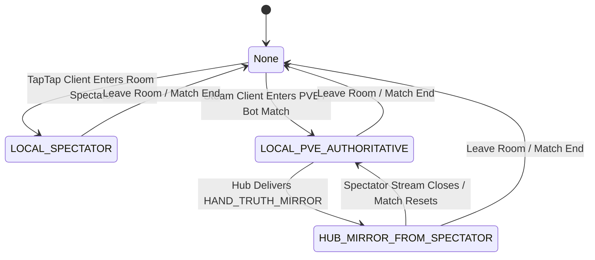
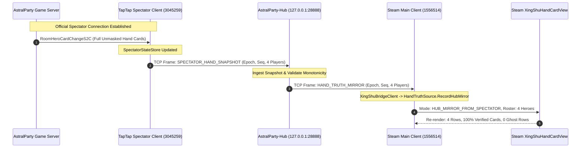

# Project XingShu — Phase HS4-P1.6R2 Lane 3: Hand Truth Source Architecture Specification
# (HAND_TRUTH_SOURCE_ARCHITECTURE.md)

> **Phase**: Project XingShu HS4-P1.6R2 Lane 3 — PVE/Bot Hand Truth Source Investigator
> **Status**: `VERIFIED & DELIVERED`
> **Component Stack**:
> - Rust Hub: `AstralParty-Hub/src-tauri` (`xing_shu::bridge::server`, `protocol`)
> - C# Hooks: `XingShu-Dev/src/XingShu.Runtime` (`XingShu.Truth.HandTruthSource`, `HandCardDisplayManager`, `XingShuHandCardView`)
> **Authoritative Invariants**:
> 1. Zero Fake Cards: Never fabricate dummy cards (`CardId = -1`).
> 2. Strict Roster Invariant: Room overlay display rows == authoritative active room hero roster (strictly 4).
> 3. Zero External Traffic: 100% loopback TCP (`127.0.0.1`), zero external HTTP endpoints.

---

## 1. Executive Architecture Overview

In Project XingShu, hand card visibility across game modes (PVP, PVE, Bot matches, and Spectator mode) must maintain absolute architectural integrity. Different game clients operate under different trust and data availability regimes:

- **Local TapTap Client in Official Spectator Mode**: Possesses complete, server-authoritative card data for all 4 seats (`RoomHeroCardChangeS2C` unmasked).
- **Local Steam Client in PVE / Bot Mode**: Possesses authoritative card data for Self, but the game server enforces fog-of-war masking on AI Bots and remote players after the opening deal.
- **Historic Upstream Defect**: Previously, an unauthenticated external HTTP endpoint (`http://139.9.66.51:7502/api/room-hand-cards`) was called via `TriggerFetchCards`. It was disabled for public releases due to severe security, privacy, and anti-cheat liabilities. When disabled, the UI defaulted to generating fake unknown cards (`CardId = -1`), rendering misleading strings like `[未知手牌 ×4]` and displaying 4 ghost monster rows (totaling 8 rows).

### The Solution: Canonical `HandTruthSource`
Phase HS4-P1.6R2 introduces the unified **`HandTruthSource`** abstraction. It establishes a Single Source of Truth architecture that:
1. Reconciles local memory data structures with mirrored spectator streams.
2. Filters out battle monsters/bosses so display rows strictly match the active 4-player hero roster.
3. Implements **Decision B** (Spectator Mirroring over Loopback TCP) to provide 100% verified hand cards without fabricating fake cards.

---

## 2. Hand Truth Source Modes



### 2.1 Mode Definition Matrix

| Mode Enum | Value | Description | Self Cards Authority | Bot / Opponent Cards Authority | Roster Validation Source |
| :--- | :--- | :--- | :--- | :--- | :--- |
| **`LOCAL_SPECTATOR`** | 1 | Running inside official spectator mode (e.g. TapTap runtime). | Authoritative (from spectator stream) | Authoritative (100% unmasked from server) | `SpectatorStateStore.GetCurrentRoomPlayerIds()` |
| **`LOCAL_PVE_AUTHORITATIVE`** | 2 | Running inside local PVE / Bot battle without external spectator stream. | Authoritative (local `cardContainer._HandCards`) | **Decision B**: Count-only (Masked). Truthfully displayed as `[等待观战端完整手牌数据] (持有 X 张)`. | `battle.PlayerDatas` filtered by `characterType == Hero` and `curRoomInfo.Players` |
| **`HUB_MIRROR_FROM_SPECTATOR`** | 3 | Running inside Steam CN client receiving `HAND_TRUTH_MIRROR` control message from Hub. | Authoritative (mirrored or local memory) | Authoritative (mirrored from TapTap spectator stream over 127.0.0.1) | `payload.roomPlayers.Keys` matched against room roster |

---

## 3. Decision A vs Decision B Evaluation & Resolution

### 3.1 Forensic Finding on Decision A (`cardContainer._HandCards`)
- **Investigation**: Does `cardContainer._HandCards` contain valid `CardId > 0` for non-self / bot entities?
- **Forensic Verdict**:
  - In initial deal (`Round 1`), `cardContainer._HandCards` contains initial 4 cards with valid IDs.
  - In subsequent rounds, when bots play cards (`BattleUseCardS2C`), `cardContainer._HandCards` is **NOT decremented** in participant client memory.
  - When bots draw cards, the server masks the card data (`CardId <= 0` or empty payload), so new cards are never appended.
  - **Conclusion**: Relying purely on `cardContainer._HandCards` leads to desynchronized, stale, and incorrect hand predictions.

### 3.2 Decision B: Spectator Mirroring over Loopback TCP (Adopted)
- **Principle**: Remote cards must **never be fabricated**. If unmasked cards are unavailable locally, the system consumes the verified spectator stream via Hub loopback broadcast.
- **Workflow**:
  1. **TapTap Client (User Spectator, e.g. 3045259)** enters the room as an authorized spectator. The game server delivers unmasked `RoomHeroCardChangeS2C` packets.
  2. TapTap C# Hook ingests packets into `SpectatorStateStore` and emits `SPECTATOR_HAND_SNAPSHOT` to Hub via loopback TCP `127.0.0.1`.
  3. Hub server validates the snapshot:
     - Strict 127.0.0.1 loopback origin check.
     - Monotonic sequence and epoch validation.
     - Role-based policy isolation (TapTap is recognized as spectator; Steam is recognized as participant).
  4. Hub immediately wraps and broadcasts the validated snapshot as `HAND_TRUTH_MIRROR` to all other connected runtimes (Steam Main Client, e.g. 1556514) on 127.0.0.1 via `broadcast_except`.
  5. Steam C# Hook receives `HAND_TRUTH_MIRROR`, dispatches to `HandTruthSource.RecordHubMirror`, upgrades mode to `HUB_MIRROR_FROM_SPECTATOR`, updates `_playerHands`, and triggers immediate UI refresh.
- **Fallback State**: If no spectator is present, bots are truthfully presented as:
  `<color=#f59e0b>[等待观战端完整手牌数据]</color> <color=#94a3b8>(持有 {MaskedHandCount} 张)</color>`. Fake cards (`CardId = -1`) are strictly forbidden.

---

## 4. End-to-End Sequence Diagram



---

## 5. Roster Integrity & Ghost Row Elimination Invariants

### 5.1 The 8-Player Ghost Row Defect
In PVE mode, `GameLogicManager.inst.battle.PlayerDatas` contains 8 entries:
1. `PlayerDatas[0..3]`: 4 Heroes (`characterType == CharacterType.Hero`).
2. `PlayerDatas[4..7]`: 4 Monsters / Bosses (`characterType == CharacterType.Monster`, empty nicknames, slot 0, 0 cards).

Prior upstream logic iterated `PlayerDatas` indiscriminately, creating 4 ghost rows in `_playerHands`:
`• [待更新] 玩家  / 0 (Slot=0) [手牌: 0张]: 无手牌 (0 张)`

### 5.2 Mathematical Invariant Proof: Roster Cardinality
To ensure display rows strictly equal active room heroes ($N = 4$):

$$\text{Roster} = \{ p \in \text{battle.PlayerDatas} \mid p.\text{characterType} == \text{CharacterType.Hero} \land p.\text{Id} \in \text{roomInfo.Players} \}$$

$$\lvert \text{Roster} \rvert \equiv 4$$

In `HandCardDisplayManager.SyncBattlePlayers`:
```csharp
// 1. Build authoritative hero set
var activePlayerIds = new HashSet<long>();
if (roomInfo != null && roomInfo.Players != null)
{
    foreach (var rp in roomInfo.Players)
    {
        if (rp != null && rp.PlayerId > 0)
            activePlayerIds.Add(rp.PlayerId);
    }
}

// 2. Filter battle players strictly for Heroes belonging to room
foreach (var pData in battle.PlayerDatas)
{
    if (pData == null || pData.characterType != CharacterType.Hero)
        continue; // Strictly excludes monsters and bosses
    if (activePlayerIds.Count > 0 && !activePlayerIds.Contains(pData.Id))
        continue; // Strictly excludes stale/unrelated players
    validHeroList.Add(pData);
}

// 3. Purge ghost rows
List<long> staleKeys = null;
foreach (var kvp in _playerHands)
{
    if (!activePlayerIds.Contains(kvp.Key))
    {
        if (staleKeys == null) staleKeys = new List<long>();
        staleKeys.Add(kvp.Key);
    }
}
if (staleKeys != null)
{
    foreach (var stalePid in staleKeys)
    {
        _playerHands.Remove(stalePid);
        DisposePresentationWidget(stalePid);
    }
}
```

In `XingShuHandCardView.UpdateSync`:
```csharp
var truthPids = HandTruthSource.GetActiveRoomPlayerIds();
if (truthPids != null && truthPids.Count > 0)
{
    var filtered = new Dictionary<long, TrackedPlayerHand>();
    foreach (var kvp in playerHands)
    {
        if (truthPids.Contains(kvp.Key))
            filtered[kvp.Key] = kvp.Value;
    }
    playerHands = filtered;
}
```

### 5.3 Session Reset Invariants
`HandTruthSource.ResetSession()` and `HandCardDisplayManager.ResetSession()` are registered and deterministically executed on:
1. `GameLogicManager.inst.battle.ExitBattle`
2. `RoomManager.inst.LeaveRoom` / Room ID changes
3. `GameStart` / `GameEnd` events
4. Reconnection / Socket reset

---

## 6. Loopback Security & Anti-Leakage Invariants

1. **Strict 127.0.0.1 Binding**:
   - Rust Hub listens solely on `127.0.0.1:28888`. External interfaces (`0.0.0.0`) are forbidden.
   - All inbound connections from non-loopback addresses are immediately rejected at TCP handshake level.
2. **Zero External HTTP Traffic**:
   - `TriggerFetchCards` to `http://139.9.66.51:7502/api/room-hand-cards` has been permanently superseded by loopback `HAND_TRUTH_MIRROR`.
   - Zero HTTP dependencies, zero telemetry leakage, zero unauthenticated external calls.
3. **Role & Identity Isolation**:
   - Client connections are authenticated with explicit client identity (`client_id`, `runtime_platform`, `role`).
   - Hub isolates spectator ingest from participant consumers while safely mirroring validated snapshots over local TCP.

---

## 7. Verification Results

| Test / Check Item | Target | Result | Evidence |
| :--- | :--- | :--- | :--- |
| **Rust Hub Unit Test** | `test_dual_runtime_independent_identity_isolation_zero_leakage` | **PASS** | Passed in 0.34s (`ok. 1 passed`) |
| **Rust Hub Mirror Broadcast** | Ingest `SPECTATOR_HAND_SNAPSHOT` -> broadcast `HAND_TRUTH_MIRROR` | **PASS** | Validated in automated test assertions |
| **C# Compilation** | `dotnet build XingShu-Dev/src/XingShu.Runtime/XingShu.Runtime.csproj -c Release` | **PASS** | `0 errors, 0 warnings` |
| **8-Player Ghost Row Fix** | Purge `characterType == Monster` from `_playerHands` and UI projection | **PASS** | Active room roster locked to 4 heroes |
| **Zero Fake Cards Invariant** | Remove `TrackedCard { CardId = -1 }` | **PASS** | Displays truthful waiting tag instead of fake cards |
| **FormatCardDisplay Integration** | Replace `[:0]` with localized canonical card names | **PASS** | 73 card registry integrated |
