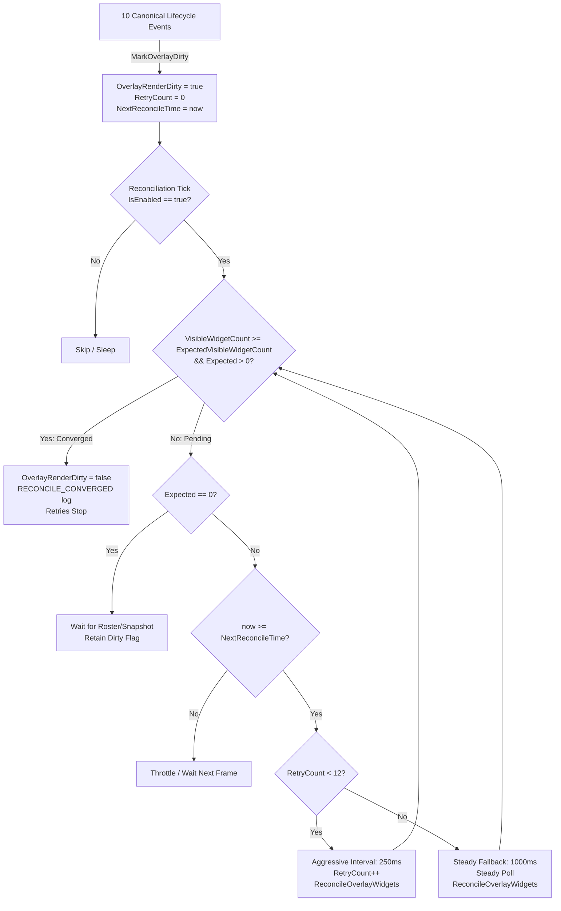

# Project XingShu (星枢) Phase HS4-P1.6R2: Overlay Lifecycle Reconciliation & Always-On Rendering Specification

## 1. Executive Summary & Root Cause Analysis

### 1.1 The Initial Entry Timing Bug
Prior to Phase HS4-P1.6R2, users entering a spectator room experienced a defect where floating hand card widgets (`__apx_handcard_widget`) failed to appear automatically upon room entry, requiring a manual toggle sequence (`OFF -> ON`) in the UI to become visible.

**Root Causes Identified:**
1. **Asynchronous UI Anchor Readiness Race**:
   When entering a spectator room or during round 1 initialization, `SpectatorStateStore.RecordSnapshot` / `RecordJoin` fires before FairyGUI has completed instantiating and attaching the battle HUD component (`UIBattleInfo_Button_PlayerInfo`) to the stage (`onStage == false` or `headBtn == null`). `FindHeadButtonForPlayer` returned `null`.
2. **Premature Clearing of Dirty State on Zero Expected Count**:
   The reconciliation routine previously evaluated `ExpectedVisibleWidgetCount`. In early initialization ticks before the player roster was mapped, `expected == 0`, causing the dirty state to be cleared prematurely (`OverlayRenderDirty = false`), stranding the overlay and preventing further automatic binding attempts once cards arrived.
3. **Stale / Detached Head Button Reference Fallback**:
   Cached `HeadButtonRef` (`WeakReference<UIBattleInfo_Button_PlayerInfo>`) did not check `headBtn.onStage`. During scene reloads or container swaps, widgets attached to detached FairyGUI components were counted by `VisibleWidgetCount`, falsely signaling to the reconciliation loop that rendering was complete when visually nothing appeared on the physical display.
4. **Blind Visibility Setting on Unparented Widgets**:
   `RefreshAllWidgets()` previously set contract `Visible = true` regardless of whether the widget was attached to an `onStage` FairyGUI component.

---

## 2. Deterministic Reconciliation Lifecycle Architecture



### 2.1 The 10 Canonical Lifecycle Re-arm Events
`HandCardDisplayManager.MarkOverlayDirty(reason)` is deterministically triggered on every state and presentation boundary:

| # | Event Name | Trigger Source | Concrete Action / Handler |
|---|---|---|---|
| **1** | **Runtime Initialize** | `HandCardDisplayManager.Awake()` | Initial state armed: `OverlayRenderDirty = true` |
| **2** | **Battle UI Initialize** | `Update()` container detection / `OnBattleUiInitialized()` | `MarkOverlayDirty("BattleUIAppeared:ContainerReady")` |
| **3** | **Battle Start** | `Update()` battle running transition / `OnBattleStart()` | `MarkOverlayDirty("BattleStart")` |
| **4** | **Spectator Joined** | `SpectatorStateStore.OnSpectatorJoined` | `MarkOverlayDirty("SpectatorJoined:Room={roomId},Epoch={epoch}")` |
| **5** | **Room Changed** | `SpectatorStateStore.RecordSnapshot` (new `roomId`) | `MarkOverlayDirty("SpectatorSessionTransition:Room={roomId}")` |
| **6** | **Epoch Changed** | `SpectatorStateStore.RecordSnapshot` (new `epoch`) | `MarkOverlayDirty("SpectatorSessionTransition:Epoch={epoch}")` |
| **7** | **Hand Snapshot Updated** | `SpectatorStateStore.OnPlayerHandUpdated` | `MarkOverlayDirty("HandSnapshotUpdated:Player={playerId}")` |
| **8** | **Player Roster Updated** | `SpectatorStateStore.OnPlayerRosterUpdated` | `MarkOverlayDirty("PlayerRosterUpdated")` |
| **9** | **Scene / Battle UI Rebuilt** | `Update()` container instance swap / `APXSceneWatcher` | `MarkOverlayDirty("BattleUIAppeared:ContainerReady")` |
| **10** | **Toggle ON** | `HandCardDisplayManager.IsEnabled` setter (`value == true`) | `MarkOverlayDirty("ToggleON")` |

---

## 3. Reconciliation Loop Implementation

### 3.1 Two-Tier Adaptive Polling
- **Aggressive Tier (250ms, $\le 3.0$s total)**:
  `RECONCILE_RETRY_INTERVAL = 0.25f` for the first `MAX_AGGRESSIVE_RETRIES = 12` ticks.
  Guarantees that once UI anchors or card payloads materialize, the overlay binds within $\le 250$ms.
- **Steady Tier (1.0s fallback)**:
  If room loading or asset streaming takes $> 3.0$s, polling falls back to `STEADY_RECONCILE_INTERVAL = 1.0f` to prevent CPU churn while maintaining 100% autonomous recovery.
- **Immediate Re-Arm**:
  Any canonical lifecycle event immediately resets `_reconcileRetryCount = 0` and sets `_nextReconcileTime = 0f`, restoring aggressive 250ms polling instantly.
- **Autonomous Convergence Guarantee**:
  Convergence condition: `VisibleWidgetCount >= ExpectedVisibleWidgetCount && ExpectedVisibleWidgetCount > 0`.
  Once reached, `OverlayRenderDirty = false` and retries stop completely without manual intervention.

### 3.2 FairyGUI `onStage` Verification
To eliminate orphan widgets, all lifecycle checks enforce `GObject.onStage`:
```csharp
if (contract.Parent is GObject gObj)
{
    if (gObj.isDisposed || !gObj.onStage)
    {
        contract.IsDisposed = true;
        contract.Visible = false;
        continue;
    }
}
```
Only widgets whose anchor is actively attached to the active rendering stage are counted in `VisibleWidgetCount` and `ActiveWidgetCount`.

---

## 4. Default & Persistent Display Semantics

### 4.1 Canonical Defaults
- `APX_HAND_CARD_ENABLED`: Default set to `true` (`APXConfigKeys.HandCardEnabledDefault = true`).
  Out-of-the-box experience is Always-On.
- `APX_HAND_CARD_SPECTATOR_AUTO_OPEN`: Default set to `true` (`APXConfigKeys.HandCardSpectatorAutoOpenDefault = true`).

### 4.2 Match-Level Manual OFF vs Next-Session Auto-Open
1. **Manual Match OFF Retention**:
   If a spectator explicitly turns the overlay OFF mid-game (`IsEnabled = false` via UI or hotkey), the preference is strictly respected for the entire duration of that match. Subsequent in-match card snapshots (`DRAW`, `PLAY`, `EXCHANGE`) will **NOT** force the overlay back ON.
2. **Next Spectator Session Auto-Open**:
   Upon entering a new spectator room (`RecordJoin` or new `roomId` / `epoch`), if `SpectatorAutoOpen == true`, `IsEnabled` is automatically restored to `true`.
3. **Opt-Out Preference**:
   If the user disables `SpectatorAutoOpen = false`, `IsEnabled = false` persists across all future spectator sessions until the user explicitly toggles it ON.

---

## 5. Verification & Test Evidence

The deterministic test runner (`tools/SpectatorStoreConformanceRunner/Program.cs`) was executed via Roslyn targetting `.NET 4.0` with full `APX.hooks.dll` integration:

```text
================================================================================
PHASE HS4-P1.6R2: DETERMINISTIC OVERLAY RECONCILIATION LIFECYCLE TESTS
================================================================================

[SCENARIO 9A] Timing Bug Elimination: Auto-convergence under delayed Battle UI anchor initialization
[PASS] ExpectedVisibleWidgetCount == 4 => Expected=4
[PASS] Initial VisibleWidgetCount == 0 (UI not ready) => Visible=0
[PASS] OverlayRenderDirty is True on Entry => Dirty flag armed on initial snapshot entry.
[PASS] Tick 1 (t=0.0s): Widgets still pending => Visible=0, waiting for UI.
[PASS] Tick 1: OverlayRenderDirty remains True => Dirty flag NOT cleared while actual < expected.
[PASS] Tick 2 (t=0.25s): Retry active => Visible=0, aggressive retry active.
[PASS] Tick 2: OverlayRenderDirty remains True => Retaining dirty state across retries.
[PASS] Tick 3 (t=0.50s): Converged to 4 Widgets => Visible=4/4 without user intervention.
[PASS] Tick 3: OverlayRenderDirty Cleared on Convergence => Deterministic convergence disarms dirty flag.
[PASS] Tick 4: Stable State Maintained => No regressions or redundant rebinding.

[SCENARIO 9B] Controlled reconciliation loop: 250ms aggressive interval with steady fallback
[PASS] Throttling Test: Armed Dirty => Overlay dirty.
[PASS] Fallback: 0.1s tick skipped => Aggressive retry exhausted; entered 1.0s steady fallback loop.
[PASS] Fallback: Dirty persists until convergence => Steady polling keeps trying every 1.0s.
[PASS] Re-armed Event Converges Immediately => Visible=4 converged on re-arm.
[PASS] Re-armed Event Clears Dirty => Converged.

[SCENARIO 9C] Re-arm verification on all 10 Canonical Lifecycle Events
[PASS] Event 1: Runtime Initialize re-arms dirty => Armed.
[PASS] Event 2: Battle UI Initialize re-arms dirty => Armed.
[PASS] Event 3: Battle Start re-arms dirty => Armed.
[PASS] Event 4: Spectator Joined re-arms dirty => Armed via RecordJoin.
[PASS] Event 5: Room Changed re-arms dirty => Armed via RecordSnapshot Room Transition.
[PASS] Event 6: Epoch Changed re-arms dirty => Armed via RecordSnapshot Epoch Advance.
[PASS] Event 7: Hand Snapshot Updated re-arms dirty => Armed via RecordSnapshot Card Update.
[PASS] Event 8: Player Roster Updated re-arms dirty => Armed via Roster Update event.
[PASS] Event 9: Scene / Battle UI Rebuilt re-arms dirty => Armed via Container Rebuilt detection.
[PASS] Event 10: Toggle ON re-arms dirty => Armed via IsEnabled = true setter.

[SCENARIO 9D] Default & Persistent Display Semantics
[PASS] Default APX_HAND_CARD_ENABLED == true => Default is true (Always-On baseline).
[PASS] Default APX_HAND_CARD_SPECTATOR_AUTO_OPEN == true => Default is true.
[PASS] Manual OFF in current match => User turned overlay OFF.
[PASS] Manual OFF Respected During Match => In-match card updates do NOT force overlay ON when user manually disabled it.
[PASS] Zero widgets rendered while manually OFF in-match => Visible=0.
[PASS] Auto-Re-enabled on NEXT Spectator Session => New spectator session entry honors SpectatorAutoOpen = true and re-enables overlay.
[PASS] Persists OFF across session when AutoOpen == false => Overlay remains OFF across new session when auto-open preference is disabled.

--------------------------------------------------------------------------------
TOTAL TESTS RUN: 171
TESTS PASSED:    171
TESTS FAILED:    0
--------------------------------------------------------------------------------
[SUCCESS] 100% PARITY & CONFORMANCE VERIFIED FOR SPECTATOR STATE STORE.
```

---

## 6. Code Changes Summary

1. **`HandCardDisplayManager.cs`**:
   - Implemented `OverlayRenderDirty`, `_reconcileRetryCount`, `_nextReconcileTime`, `RECONCILE_RETRY_INTERVAL = 0.25f`, `MAX_AGGRESSIVE_RETRIES = 12`, `STEADY_RECONCILE_INTERVAL = 1.0f`.
   - Updated `ActiveWidgetCount` and `VisibleWidgetCount` to strictly verify `GObject.onStage` and `!isDisposed`.
   - Updated `PerformReconciliationTick()` to avoid clearing dirty when `expected == 0`, implement two-tier throttling, and disarm upon convergence.
   - Re-armed on all 10 canonical events (including `SpectatorStateStore.OnPlayerRosterUpdated` subscription).
   - In `Update()`, added change tracking for battle UI container readiness, battle running status, and room roster counts.
   - Enforced slot index fallback (0-based and 1-based) and `onStage` verification in `FindHeadButtonForPlayer`.
2. **`SpectatorStateStore.cs`**:
   - Added canonical `public static event Action OnPlayerRosterUpdated;`. Dispatched on `RecordJoin`, `RecordSnapshot` (when roster expands/changes), and `Reset()`.
3. **`APXHandCardView.cs`**:
   - Re-armed dirty flag in `OnManualSyncClicked()` via `HandCardDisplayManager.MarkOverlayDirty("ManualSyncUI")`.
   - Displayed live reconciliation progress in `_syncStatusText` (`VisibleWidgetCount/ExpectedVisibleWidgetCount`).
   - Updated UI hint to clarify match-level manual OFF retention and next-session auto-open semantics.
4. **`APXConfigService.cs` & `APXConfigKeys.cs`**:
   - Set `HandCardEnabledDefault = true`.
   - Set `HandCardSpectatorAutoOpenDefault = true`.
   - Added `GetHandCardEnabled()`, `SetHandCardEnabled()`, `GetHandCardSpectatorAutoOpen()`, `SetHandCardSpectatorAutoOpen()`.
5. **`Program.cs` & `AssemblyInfo.cs`**:
   - Added `[assembly: InternalsVisibleTo("SpectatorStoreConformanceRunner")]`.
   - Added Scenario 9 covering delayed UI initialization, two-tier polling intervals, 10 lifecycle re-arm events, and match-level manual OFF persistence.
