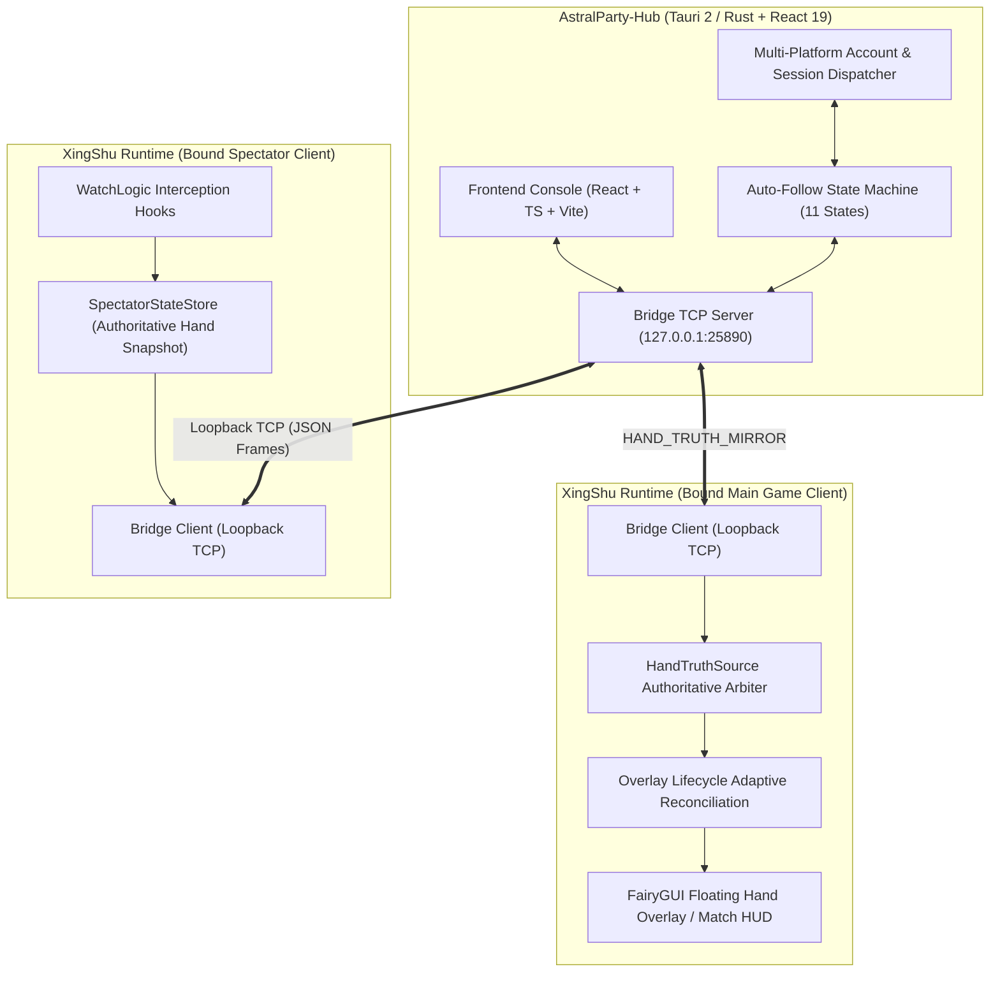

# XingShu (星枢)【吉星派对游戏助手】

[项目文档与验证记录](docs/README.md)

<p align="center">
  <strong>Multi-client game enhancement runtime and cross-process control hub for Astral Party</strong>
</p>

<p align="center">
  <a href="README.md">English</a> · <a href="README_CN.md">简体中文</a>
</p>

<p align="center">
  
  
  
  
  
</p>

---

## Stable Release

[Download XingShu v0.1.1](https://github.com/Breezecaresses/Xingshu-hub/releases/tag/v0.1.1). The Windows and Android packages support Astral Party 3.3.0, resource 150.

- **Windows** · One ZIP contains XingShu Hub, the installer, and game plugins for Steam China, TapTap Windows, Bilibili, and WeGame. Extract the entire ZIP and open `星枢安装助手.exe`.
- **Android** · One ZIP contains the phone installer APK, manual replacement files, and official recovery files. The installer now includes installation and usage guides and can back up conflicting files at the same resource path before an explicitly confirmed replacement. See the [phone installation guide](docs/guides/ANDROID_PHONE_INSTALL.md).

This release restores the floating menu after the official update and adapts the hero-selection timer hook. The Steam China floating menu and Xiaomi phone startup, menu, hand page, and installer guides passed manual acceptance; the other three desktop channels passed file compatibility checks. The streaming privacy experiment is archived. See the [release record](docs/records/RELEASE_20261112.md).

Both applications retain the existing signed update feed. The separate updater APK is byte-identical to the one in the Android ZIP. Updating an application does not replace the game plugin: exit the game and use the installer afterward. See the [packaging guide](docs/guides/RELEASE_PACKAGING.md).

---

## 📖 Overview

**XingShu (星枢)** is a local multi-process workstation and game enhancement runtime suite developed for *Astral Party* (吉星派对).

The project consists of two core components:
1. **AstralParty-Hub**: A modern desktop management hub built on Tauri 2 + Rust + React 19. It provides isolated account management, runtime lifecycle supervision, local loopback communication relay, and automated room following for spectating.
2. **XingShu Runtime**: A C# Unity enhancement module injected into the game client. It provides floating card status overlays, HUD widgets, match statistics, adaptive lifecycle reconciliation, and authoritative hand truth mirroring.

---

## Current Runtime Status

In a supported co-op match with spectating enabled, the desktop runtime can display live teammate cards beside the avatars. Keep the Hub open and sign in with the game account in use. Steam China was verified in a four-human co-op match. TapTap, Bilibili, and WeGame passed installation file checks.

For local spectating, use a separate signed-in official spectator client. See the [local watcher notes](AstralParty-Hub/docs/local-managed-watcher.md).

## Hub and Runtime Update

- The character library includes 37 official configurations, including two unfinished preview entries. Missing names, skills, and artwork remain explicitly pending.
- Character, skin, bond, and growth details; full portrait card layouts and native animated alternate artwork; token and map/field-effect libraries.
- Match history and settlement details persist per account. PVE uses victory/defeat; PVP uses placement. Support transfers receive more rating weight; remaining gold is excluded from ratings.
- Runtime, packages, plugins, and mods use five channels and explicit installation directories, including multiple locations per channel. Externally installed files show detection status only.
- Runtime management separates file verification, the actual game process, and the version reported by a confirmed connection. This bundle includes checked payloads for Steam China, TapTap Windows, Bilibili, and WeGame.
- The Hub sidebar, settings, and plugin F1 center link to the project source. The desktop runtime build is r8.24. New character and map configurations have not been fully re-exported; the library retains its previous data.
- The in-game center now uses translucent surfaces without background stripes, the game's font, and official star-shaped sliders. Colored text previews are fixed. Target selection keeps native panning and the user's zoom; labels and leader lines shrink when zooming out. See the [UI and camera validation record](docs/records/GAME_UI_R1.md) for tested behavior and pending checks.

See [extension channel documentation](AstralParty-Hub/docs/specs/extension_channels.md) for manifests, destination mappings, and management boundaries. Game artwork, configuration, and resources remain the property of their respective owners and are not relicensed under the code's MIT license.

## Android

The phone installer supports local wireless debugging on Android 11 and later. On Xiaomi 14 Pro, the 0.1.1 installation and usage guides, r8.24 game startup, floating star, function center, and hands page were verified. The complete live co-op cloud-hand flow still requires device verification for this release. See the [Android compatibility guide](docs/guides/ANDROID_COMPATIBILITY.md).

## 🏗️ Architecture Overview



---

## ✨ Key Features

- **Authoritative Hand Truth System (`HandTruthSource`)**:
  - The full-hand mirror passes through the Hub over `127.0.0.1` loopback communication. Official game authentication and spectating use the game's own server connections.
  - **No Fake/Placeholder Cards**: Rendering forged placeholder cards (`CardId = -1`) is strictly forbidden; hand card data is strictly validated against the match hero roster.
  - Once the spectator client acquires complete authoritative data, it is mirrored and pushed to the main game client in real-time via the local Hub.
- **Deterministic Overlay Lifecycle Reconciliation**:
  - Solves issues where FairyGUI widgets detach or fail to auto-initialize due to node unmounting or scene transitions.
  - Driven by 10 distinct lifecycle events with an adaptive two-tier polling and retry mechanism, ensuring hand overlays remain precisely aligned with player avatars at all times.
- **Secure & Isolated Auto-Follow Protocol**:
  - Managed by a strict 11-state finite state machine that automatically detects matches in the main game and guides the spectator client into the room.
  - **Bound Account Routing**: Auto-follow instructions target the configured spectator role, platform, and current player identity, with connection and match checks separating it from the main account.
- **Multi-Platform Account Binding & Scheduling**:
  - Supports concurrent management and routed launching of multiple accounts across Steam, TapTap, and other platforms.
  - Automatically cleans up overlay state, vacates spectator rooms, and resets match fingerprints across game sessions.

---

## 📁 Directory Structure

```text
XingShu/
├── AstralParty-Hub/            # Desktop management console
│   ├── src/                    # Frontend source (React 19, TypeScript, TailwindCSS)
│   │   ├── pages/              # UI pages (Spectator, Account Center, Runtime, Diagnostics, etc.)
│   │   ├── services/           # Core services (Auto-follow, Truth Arbiter, Account Management)
│   │   └── shared/             # Shared card registry and data models
│   ├── src-tauri/              # Tauri Rust backend
│   │   ├── src/xing_shu/       # Local TCP bridge server, protocol codec, spectator stream
│   │   └── Cargo.toml          # Rust dependency configuration
│   └── package.json            # Frontend dependency configuration
├── XingShu-Dev/                    # In-game C# runtime module
│   ├── src/XingShu.Runtime/          # XingShu core logic (HandTruthSource, UI widgets, protocol client)
│   ├── tools/                  # MSBuild scripts, lifecycle tests, and bootstrapping tools
│   └── assets/                 # In-game UI assets and icons (vanilla-ui-r3)
├── tools/                      # Automation tooling (registry generators, patch scripts, source sync)
├── AUTO_FOLLOW_PROTOCOL.md     # Auto-follow local control protocol specification
├── AUTO_FOLLOW_STATE_MACHINE.md# Auto-follow 11-state finite state machine specification
├── HAND_TRUTH_SOURCE_ARCHITECTURE.md # Hand truth source & single-source-of-truth architecture
├── OVERLAY_LIFECYCLE_RECONCILIATION.md # Deterministic overlay lifecycle reconciliation specification
├── runtime_card_registry.generated.json # Authoritative card definition registry
└── LICENSE                     # Open source license (MIT)
```

---

## 🛠️ Build & Setup Guide

> [!NOTE]
> In compliance with open-source licensing and distribution ethics, this repository **does not contain** any proprietary original game binaries (DLLs), sensitive account credentials, or proprietary assets.

### 1. AstralParty-Hub (Desktop Console)

#### Prerequisites
- Node.js (v18+ LTS recommended)
- Rust & Cargo (latest stable toolchain)
- Visual Studio C++ Build Tools (Windows C++ Build Tools)
- Microsoft Edge WebView2

#### Build Steps
```bash
# Navigate to the Hub directory
cd AstralParty-Hub

# Install dependencies
npm ci

# Build Tauri desktop application (unpackaged binary mode)
npm run tauri -- build --no-bundle
```

---

### 2. XingShu Runtime (C# Game Runtime)

#### Prerequisites
- Visual Studio MSBuild with C# 11 support; the project targets .NET Framework 4.0 using the game's reference assemblies
- Python 3.x
- Mono.Cecil and Mono.Cecil.Rocks (placed in `XingShu-Dev/tools/lib`)

#### Dependency Setup
Extract the matching version of `AstralParty.Runtime.dll` from your legally owned game client and place it in the default path:
`XingShu-Dev/references/updated_20261019_verified/` (or specify the `AstralPartyRuntimePath` MSBuild property in your build configuration).
Place other dependency assemblies into `XingShu-Dev/references/{unity,framework,thirdparty}` as needed.

#### Build Steps
```powershell
# Execute build script
.\XingShu-Dev\tools\build.ps1 -Configuration Release
```

---

When refreshing this checkout from the development workspace, run `python tools/export_source_repo.py <source-checkout-path>` there and review the diff. Existing README files and `.gitignore` are maintained in this checkout and preserved by the export tool.

## 📚 Detailed Documentation

- [AUTO_FOLLOW_PROTOCOL.md](docs/guides/AUTO_FOLLOW_PROTOCOL.md) — Auto-Follow Local TCP Communication Protocol Specification
- [AUTO_FOLLOW_STATE_MACHINE.md](docs/guides/AUTO_FOLLOW_STATE_MACHINE.md) — Auto-Follow 11-State Finite State Machine Design & Transition Matrix
- [HAND_TRUTH_SOURCE_ARCHITECTURE.md](docs/guides/HAND_TRUTH_SOURCE_ARCHITECTURE.md) — Single Source of Truth Architecture & Counter-Forgery Design
- [OVERLAY_LIFECYCLE_RECONCILIATION.md](docs/guides/OVERLAY_LIFECYCLE_RECONCILIATION.md) — Floating Overlay Adaptive Lifecycle Reconciliation Specification
- [local-managed-watcher.md](AstralParty-Hub/docs/local-managed-watcher.md) — Locally Managed Watcher Work Unit Technical Guide

---

## ⚠️ Disclaimer & Ethical Boundaries

1. This project is intended solely for technical research, local automated testing, and educational purposes.
2. This project does not distribute or bundle any proprietary assemblies, decompiled artifacts, or commercial assets from the original game. Users must provide their own legitimately obtained game installations.
3. Please use companion utilities responsibly and adhere to the official Terms of Service and End User License Agreement of the game. The developers assume no liability for any account penalties, bans, or losses resulting from misuse.

---

## 📄 License

This project is open-source under the [MIT License](LICENSE).
