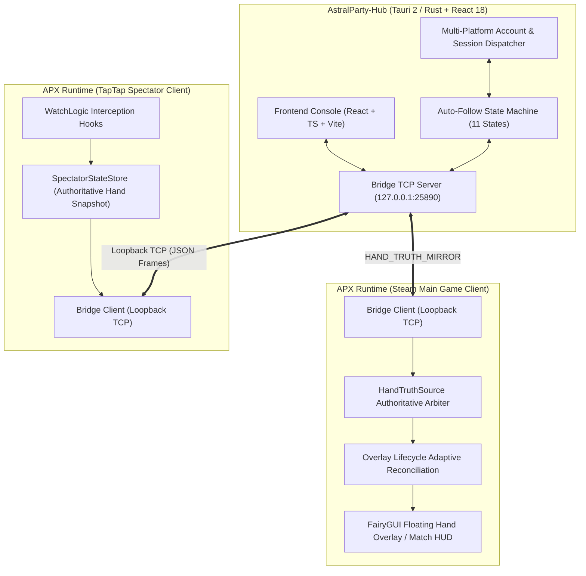

# XingShu (星枢)

<p align="center">
  <strong>Multi-client game enhancement runtime and cross-process control hub for Astral Party</strong>
</p>

<p align="center">
  <a href="README.md">English</a> · <a href="README_CN.md">简体中文</a>
</p>

<p align="center">
  
  
  
  
  
</p>

---

## 📖 Overview

**XingShu (星枢)** is a high-performance local multi-process collaborative workstation and game enhancement runtime suite developed for *Astral Party* (星之派对).

The project consists of two core components:
1. **AstralParty-Hub**: A modern desktop management hub built on Tauri 2 + Rust + React 18. It provides isolated account management, runtime lifecycle supervision, local loopback communication relay, and automated room following for spectating.
2. **APX Runtime**: A C# Unity enhancement module injected into the game client. It provides floating card status overlays, HUD widgets, match statistics, adaptive lifecycle reconciliation, and authoritative hand truth mirroring.

---

## 🏗️ Architecture Overview



---

## ✨ Key Features

- **Authoritative Hand Truth System (`HandTruthSource`)**:
  - Completely eliminates unauthorized external HTTP third-party APIs. Operates strictly over `127.0.0.1` local loopback communication with zero outbound network data leakage.
  - **No Fake/Placeholder Cards**: Rendering forged placeholder cards (`CardId = -1`) is strictly forbidden; hand card data is strictly validated against the match hero roster.
  - Once the spectator client acquires complete authoritative data, it is mirrored and pushed to the main game client in real-time via the local Hub.
- **Deterministic Overlay Lifecycle Reconciliation**:
  - Solves issues where FairyGUI widgets detach or fail to auto-initialize due to node unmounting or scene transitions.
  - Driven by 10 distinct lifecycle events with an adaptive two-tier polling and retry mechanism, ensuring hand overlays remain precisely aligned with player avatars at all times.
- **Secure & Isolated Auto-Follow Protocol**:
  - Managed by a strict 11-state finite state machine that automatically detects matches in the main game and guides the spectator client into the room.
  - **Enforced Platform Security Boundary**: Auto-follow instructions are strictly restricted to trusted TapTap spectator clients, guaranteeing zero interference with the primary Steam account.
- **Multi-Platform Account Binding & Scheduling**:
  - Supports concurrent management and routed launching of multiple accounts across Steam, TapTap, and other platforms.
  - Automatically cleans up overlay state, vacates spectator rooms, and resets match fingerprints across game sessions.

---

## 📁 Directory Structure

```text
XingShu/
├── AstralParty-Hub/            # Desktop management console
│   ├── src/                    # Frontend source (React 18, TypeScript, TailwindCSS)
│   │   ├── pages/              # UI pages (Spectator, Account Center, Runtime, Diagnostics, etc.)
│   │   ├── services/           # Core services (Auto-follow, Truth Arbiter, Account Management)
│   │   └── shared/             # Shared card registry and data models
│   ├── src-tauri/              # Tauri Rust backend
│   │   ├── src/xing_shu/       # Local TCP bridge server, protocol codec, spectator stream
│   │   └── Cargo.toml          # Rust dependency configuration
│   └── package.json            # Frontend dependency configuration
├── APX-Dev/                    # In-game C# runtime module
│   ├── src/APX.hooks/          # APX core logic (HandTruthSource, UI widgets, protocol client)
│   ├── tools/                  # MSBuild scripts, lifecycle tests, and bootstrapping tools
│   └── assets/                 # In-game UI assets and icons (vanilla-ui-r3)
├── tools/                      # Automation tooling (registry generators, patch scripts, source sync)
├── AUTO_FOLLOW_PROTOCOL.md     # Auto-follow local control protocol specification
├── AUTO_FOLLOW_STATE_MACHINE.md# Auto-follow 11-state finite state machine specification
├── HAND_TRUTH_SOURCE_ARCHITECTURE.md # Hand truth source & single-source-of-truth architecture
├── OVERLAY_LIFECYCLE_RECONCILIATION.md # Deterministic overlay lifecycle reconciliation specification
├── runtime_card_registry.generated.json # Authoritative card definition registry
└── LICENSE                     # Open source license (MIT)
```

---

## 🛠️ Build & Setup Guide

> [!NOTE]
> In compliance with open-source licensing and distribution ethics, this repository **does not contain** any proprietary original game binaries (DLLs), sensitive account credentials, or proprietary assets.

### 1. AstralParty-Hub (Desktop Console)

#### Prerequisites
- Node.js (v18+ LTS recommended)
- Rust & Cargo (latest stable toolchain)
- Visual Studio C++ Build Tools (Windows C++ Build Tools)
- Microsoft Edge WebView2

#### Build Steps
```bash
# Navigate to the Hub directory
cd AstralParty-Hub

# Install dependencies
npm ci

# Build Tauri desktop application (unpackaged binary mode)
npm run tauri -- build --no-bundle
```

---

### 2. APX Runtime (C# Game Runtime)

#### Prerequisites
- Visual Studio (with .NET Framework 4.7.2+ development workload and MSBuild)
- Python 3.x
- Mono.Cecil and Mono.Cecil.Rocks (placed in `APX-Dev/tools/lib`)

#### Dependency Setup
Extract the matching version of `AstralParty.Runtime.dll` from your legally owned game client and place it in the default path:
`APX-Dev/references/updated_20261019_verified/` (or specify via the `AstralPartyRuntimePath` environment variable in your build configuration).
Place other dependency assemblies into `APX-Dev/references/{unity,framework,thirdparty}` as needed.

#### Build Steps
```powershell
# Execute build script
powershell -ExecutionPolicy Bypass -File APX-Dev/tools/build.ps1 -Configuration Release
```

---

## 📚 Detailed Documentation

- [AUTO_FOLLOW_PROTOCOL.md](AUTO_FOLLOW_PROTOCOL.md) — Auto-Follow Local TCP Communication Protocol Specification
- [AUTO_FOLLOW_STATE_MACHINE.md](AUTO_FOLLOW_STATE_MACHINE.md) — Auto-Follow 11-State Finite State Machine Design & Transition Matrix
- [HAND_TRUTH_SOURCE_ARCHITECTURE.md](HAND_TRUTH_SOURCE_ARCHITECTURE.md) — Single Source of Truth Architecture & Counter-Forgery Design
- [OVERLAY_LIFECYCLE_RECONCILIATION.md](OVERLAY_LIFECYCLE_RECONCILIATION.md) — Floating Overlay Adaptive Lifecycle Reconciliation Specification
- [local-managed-watcher.md](AstralParty-Hub/docs/local-managed-watcher.md) — Locally Managed Watcher Work Unit Technical Guide

---

## ⚠️ Disclaimer & Ethical Boundaries

1. This project is intended solely for technical research, local automated testing, and educational purposes.
2. This project does not distribute or bundle any proprietary assemblies, decompiled artifacts, or commercial assets from the original game. Users must provide their own legitimately obtained game installations.
3. Please use companion utilities responsibly and adhere to the official Terms of Service and End User License Agreement of the game. The developers assume no liability for any account penalties, bans, or losses resulting from misuse.

---

## 📄 License

This project is open-source under the [MIT License](LICENSE).
