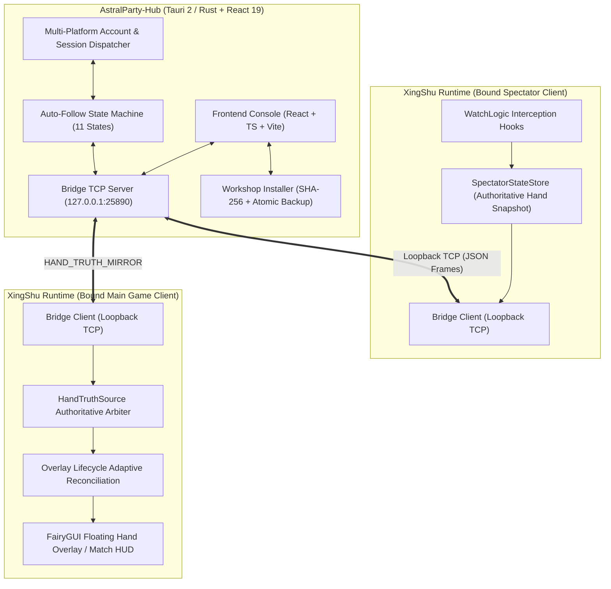

<h1 align="center">AstralParty-XingShu</h1>

<h3 align="center">Thank you for choosing AstralParty-XingShu!</h3>

<p align="center">
  <strong>Feedback &amp; Community: QQ Group <code>540929823</code> &nbsp;|&nbsp; <a href="https://discord.gg/dxVS6ZF393">Discord</a></strong>
</p>

<p align="center">
  
</p>

<p align="center">
  Replay Analysis · Live Hand Sync · Game Encyclopedia · Mod Workshop · In-Game Assist
</p>

<p align="center">
  <a href="https://github.com/Breezecaresses/AstralParty-XingShu/releases"></a>
  
  
  
  
  <a href="LICENSE"></a>
</p>

<p align="center">
  <a href="https://github.com/Breezecaresses/AstralParty-XingShu/releases">Download Latest</a> ·
  <a href="https://astralparty-xingshu.lanxichaxu.cn/xingshu-hub/">Web Edition</a> ·
  <a href="docs/README.md">Docs &amp; Validation Records</a> ·
  <a href="README.md">English</a> · <a href="README_CN.md">简体中文</a>
</p>

---

## Stable Release

[Download AstralParty-XingShu v0.1.4](https://github.com/Breezecaresses/AstralParty-XingShu/releases/tag/v0.1.4). Both the Windows and Android packages target *Astral Party* `3.3.0` (`resource 152`).

| Target | Package / Access | Highlights |
| --- | --- | --- |
| **Windows Desktop** | `XingShu_Desktop_*.zip` | Contains `AstralParty-Hub`, `星枢安装助手.exe`, and verified runtime payloads for Steam China, TapTap Windows, Bilibili, and WeGame. Also supports one-click Mod / Card / Skin Workshop installation with atomic backup and restore. |
| **Web Edition** | [astralparty-xingshu.lanxichaxu.cn/xingshu-hub](https://astralparty-xingshu.lanxichaxu.cn/xingshu-hub/) | Instant browser access for UID lookup, match replay depth analysis, live board playback, character/card/chip encyclopedia, and community Mod Workshop downloads & submissions. |
| **Android Installer** | `XingShu_Android_*.zip` & `.apk` | Includes the phone installer APK, manual replacement files, and official recovery files with interactive guides and conflict backup. See the [phone installation guide](docs/guides/ANDROID_PHONE_INSTALL.md). |

> [!NOTE]
> Updating the Hub or Android installer app does not overwrite the in-game plugin. After an app self-update, close the game cleanly and re-apply the plugin with the installer. See the [release record](docs/records/RELEASE_20261115_0.1.4.md) and [packaging guide](docs/guides/RELEASE_PACKAGING.md).

---

## Overview

**AstralParty-XingShu (星枢)** is an open-source multi-client workstation, replay analyzer, mod workshop, and in-game enhancement runtime suite built for *Astral Party* (吉星派对):

1. **AstralParty-Hub (Desktop & Web)**: Built with Tauri 2 + Rust + React 19 + TypeScript. Combines account isolation and auto-follow scheduling, `.rep` / match-ID replay frame-by-frame analysis, real-time interactive board topology, offline character/card/chip encyclopedias, and a curated **Mod / Card / Skin Workshop** (direct atomic install on Desktop, `.xspkg`/`.zip` download and creator submissions on Web).
2. **XingShu Runtime (C# / Unity)**: Injected runtime plugin featuring floating teammate hand overlays, defense/dodge guidance, monster cooldown trackers, custom camera zoom, and deterministic FairyGUI lifecycle reconciliation.

---

## Current Runtime & Hub Highlights

- **Customizable Shortcuts**: Open the in-game function center (default `F1`) → **快捷键** to remap all 12 XingShu keyboard actions, including camera movement. Supports modifier chords, conflict checks, saved settings and restoring defaults. See the [shortcut guide](docs/guides/HOTKEYS.md).
- **Replay Analyzer & Board Topology**: Full `.rep` parsing and game match ID fetching with round-by-round damage/star-coin curves, PVE monster-kill bounty attribution, chip picks, teammate transfers, interactive chart legend filtering, sortable summary tables, and step-by-step tile playback.
- **Mod / Card / Skin Workshop**: Browse optimization mods, custom cards, character skins, and voice/FX packs. Desktop users can install and restore with SHA-256 verification and atomic `.xingshu-mods` backups; creators can submit packages for review right from the Hub or Web UI.
- **Encyclopedia & Emote Portraits**: 38 official character slots (36 released + 2 preview slots), 75 cards, 93 chips/tokens, and 26 map guides synced from official resource `152`, with full-body standing artwork plus randomly rotated static character emotes for avatars.
- **Authoritative Co-op Hand Sync**: In spectatable co-op matches, keep the Hub open with the matching account signed in (or configure a dedicated local spectator client via [local-managed-watcher.md](AstralParty-Hub/docs/local-managed-watcher.md)) to display live teammate hand cards. Steam China is verified in 4-player human co-op; TapTap Windows, Bilibili, and WeGame pass file integrity checks.

---

## Architecture Overview



---

## Core Systems

- **Authoritative Hand Truth (`HandTruthSource`)**: Loops verified hand snapshots over `127.0.0.1` only; strictly validates card rosters against match heroes without forged placeholders (`CardId = -1`).
- **Deterministic Overlay Lifecycle**: Driven by 10 lifecycle signals with adaptive polling so FairyGUI hand widgets stay anchored across scene reloads.
- **11-State Auto-Follow FSM & Multi-Platform Scheduling**: Cleanly routes spectating requests between isolated main and watcher accounts across Steam, TapTap, Bilibili, and WeGame.
- **Replay Telemetry & Workshop Safety**: Server and Rust installers enforce HTTPS, strict SHA-256 verification, ZIP path-traversal/symlink/executable rejection, and recoverable baseline backups.

---

## Directory Structure

```text
AstralParty-XingShu/
├── AstralParty-Hub/                      # Tauri 2 + React 19 Desktop & Web console
│   ├── src/                              # UI pages (Replay, Workshop, Characters, Accounts)
│   ├── src-tauri/                        # Rust backend (TCP bridge, Mod/Workshop installer)
│   └── public/                           # Web assets, game catalog media, SEO metadata
├── XingShu-Dev/                          # In-game C# Unity runtime module
│   ├── src/XingShu.Runtime/              # HandTruthSource, FairyGUI HUD, F1 center
│   └── tools/                            # Build scripts and conformance tests
├── AndroidInstaller/                     # Android companion wireless-ADB installer APK
├── tools/                                # Catalog exporters, release packagers, updater tests
├── docs/                                 # User guides and validation records
└── LICENSE                               # MIT License
```

---

## Build & Setup

> [!NOTE]
> This repository **does not contain** proprietary game binaries, DLLs, or account credentials.

### 1. AstralParty-Hub (Desktop & Web)

- Prerequisites: Node.js 18+, Rust & Cargo (latest stable), MSVC C++ Build Tools, Microsoft Edge WebView2.

```bash
cd AstralParty-Hub
npm ci

# Web production bundle (served under /xingshu-hub/ by default via script)
npm run build:web

# Desktop binary (no installer bundle)
npm run tauri -- build --no-bundle
```

### 2. XingShu Runtime (C# Game Plugin)

- Prerequisites: Visual Studio MSBuild (C# 11 / .NET Framework 4.0 target), Python 3.x, Mono.Cecil in `XingShu-Dev/tools/lib`.
- Extract `AstralParty.Runtime.dll` from your legally owned game installation into `XingShu-Dev/references/updated_20261019_verified/` (or set `AstralPartyRuntimePath`).

```powershell
.\XingShu-Dev\tools\build.ps1 -Configuration Release
```

---

## Detailed Documentation

- [docs/README.md](docs/README.md) — Documentation Index & Historical Validation Records
- [AUTO_FOLLOW_PROTOCOL.md](docs/guides/AUTO_FOLLOW_PROTOCOL.md) — Auto-Follow Loopback TCP Protocol
- [AUTO_FOLLOW_STATE_MACHINE.md](docs/guides/AUTO_FOLLOW_STATE_MACHINE.md) — 11-State Finite State Machine Specification
- [HAND_TRUTH_SOURCE_ARCHITECTURE.md](docs/guides/HAND_TRUTH_SOURCE_ARCHITECTURE.md) — Hand Truth Single Source of Truth Architecture
- [OVERLAY_LIFECYCLE_RECONCILIATION.md](docs/guides/OVERLAY_LIFECYCLE_RECONCILIATION.md) — Floating Overlay Adaptive Lifecycle Reconciliation
- [local-managed-watcher.md](AstralParty-Hub/docs/local-managed-watcher.md) — Local Managed Watcher Setup
- [extension_channels.md](AstralParty-Hub/docs/specs/extension_channels.md) — Extension Channels & Manifest Boundaries

---

## Disclaimer & License

1. Intended strictly for technical research, local testing, mod management, and community tooling.
2. No proprietary game binaries or commercial game assets are relicensed; official game assets remain copyright of their respective owners.
3. Please abide by official game Terms of Service. Users assume full responsibility for their own usage.
4. Source code in this repository is licensed under the [MIT License](LICENSE).
