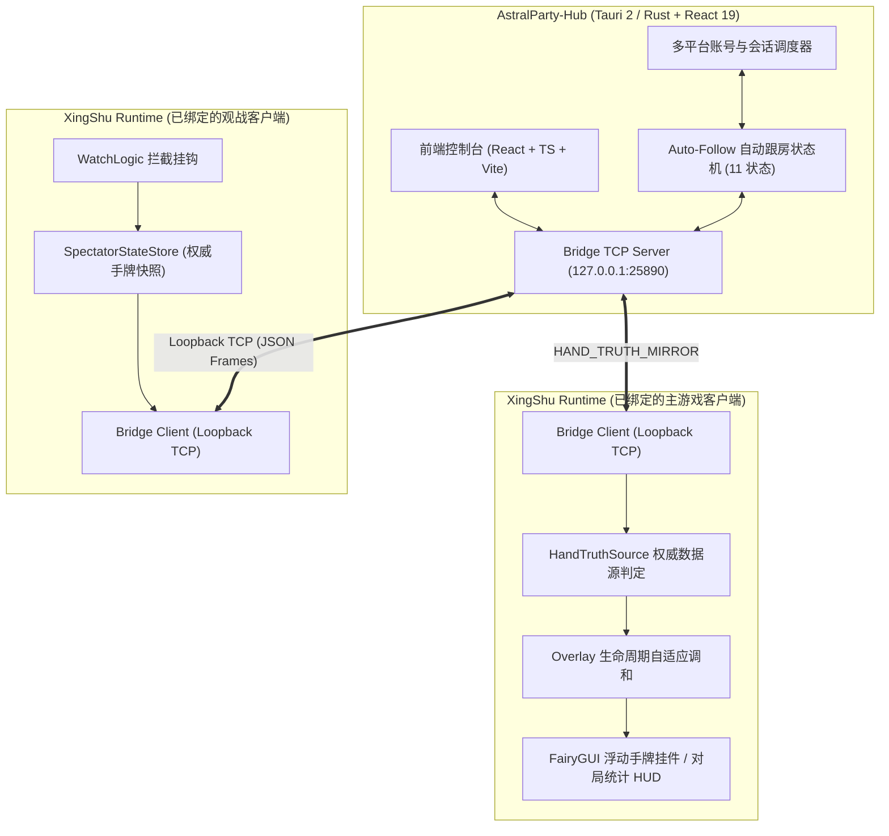

# 星枢 (XingShu)

<p align="center">
  <strong>AstralParty（吉星派对）多端游戏增强运行时与跨进程控制枢纽</strong>
</p>

<p align="center">
  <a href="README.md">English</a> · <a href="README_CN.md">简体中文</a>
</p>

<p align="center">
  
  
  
  
  
</p>

---

## 群发测试包

当前[群发测试包](https://github.com/Breezecaresses/Xingshu-hub/releases/tag/v0.1.0-test.20261021.3)标记为预发布，不作为正式稳定版。完整解压 ZIP 后运行“星枢安装助手.exe”，支持 Steam 国服、TapTap 3.3.0 / 资源026。手牌挂件默认整体60%，可调40%–120%。已知边界见[本次说明](GROUP_DISTRIBUTION_20261021_3.md)，包中不附带仅限本地验证的原生变速原型。

本版补充手机、电脑和 Hub 的移动步数统计，并统一维护源码与运行时命名。最新[安卓预览与手机安装助手](https://github.com/Breezecaresses/Xingshu-hub/releases/tag/v0.1.0-test.20261022.1)另行提供，不改动上述 Windows 包；包含手机 APK、电脑 ADB 助手及手动替换文件。手机安装需要先启动并授权 Shizuku，步骤见[手机安装说明](ANDROID_PHONE_INSTALL.md)。

---

## 📖 项目简介

**星枢 (XingShu)** 是针对《AstralParty》（吉星派对）开发的本地多进程协同工作站与游戏增强运行时套件。

项目由两大部分构成：
1. **AstralParty-Hub（星枢控制台）**：基于 Tauri 2 + Rust + React 19 构建的现代化桌面管理中枢。提供账号隔离管理、运行时生命周期监管、本地回环通信中继以及自动化观战跟房控制。
2. **XingShu Runtime（游戏增强运行时）**：注入游戏进程的 C# Unity 增强模块。提供浮动状态卡牌悬浮窗、HUD 挂件、对局统计、自适应生命周期调和以及基于权威数据源的手牌真值镜像。

---

## 当前运行状态

GitHub 仓库用于保存源码和版本记录。当前仍需在本机运行 Hub、主游戏及已登录的官方观战客户端；远程观战账号池尚未部署。

- 资源 026 已在 Steam 国服主端 + TapTap 观战端验证插件启动、身份识别及 PVE 四人手牌镜像。
- 主端已实测不重启游戏和 Hub 连续进入两个 PVE 房间，头像旁挂件显示新局手牌。
- 观战指令按绑定的 `USER_SPECTATOR` 平台和玩家身份路由。Bilibili、WeGame、Steam 国际服仍需客户端兼容及全链路实测。
- 观战端连续两局、自然结算后自动退房，以及收牌/星币/治疗自动致谢仍待实机验证。十倍思考时间修改本地计时，服务端强制截止仍有效。
- 当前完整手牌来自已登录官方观战消息；免登录全量手牌尚未实现。

验证细节和剩余工作见[本机托管观战说明](AstralParty-Hub/docs/local-managed-watcher.md)。

## 本次 Hub 与运行时更新

- 角色中心收录 37 条官方配置，包含 2 条未完整发布的预更新角色；尚缺的名称、技能与立绘标明待更新。
- 角色、皮肤、羁绊与成长详情；完整竖版卡面和原生动态异画；筹码图鉴与地图、场地效果详情。
- 对局历史和单场结算按账号保存；PVE 显示胜负、PVP 显示名次。评分提高辅助转账贡献，结算金币保留展示且不参与评分。
- 运行时、包管理器、插件与模组按五个渠道和实际安装目录管理，支持同渠道多个位置；手动文件仅展示检测状态。
- 运行时页分别展示文件校验、实际进程与已确认连接上报的版本。本版安装文件覆盖 Steam 国服和 TapTap Windows，其他渠道仍待运行时实测。
- Hub 侧栏、设置页与插件 F1 功能中心均附项目来源。当前桌面运行时版本为 `1.0.0-game-ui-r1`。
- 游戏内功能中心采用半透明无条纹框架、游戏字体与官方星形滑块，修复彩色浮字预览；选目标时保留原版平移及自定义缩放，拉远后名字与指向线缩小。实测范围及仍待确认的项目见[界面与镜头验证记录](GAME_UI_R1.md)。

扩展渠道声明、目录映射及管理边界见[扩展包说明](AstralParty-Hub/docs/specs/extension_channels.md)。游戏美术、配置及资源版权归原权利人所有，不随本项目代码的 MIT 许可证重新授权。

## 安卓运行时预览

`1.0.0-android-preview5` 在 TapTap 内置 MuMu 的 Android 12 游戏客户端（3.3.0、资源 026）验证了运行时加载、触屏入口及手机助手安装/还原。手机悬浮球默认 64、最小 48 个界面单位，可单独调整；修复自动收起设置，并保留可点击的露出区域。菜单与文字缩放保持独立，桌面默认尺寸保持原样。

小米 14 Pro、15 等实机的权限与手势仍需验证。普通 APK 不能直接取得其他应用 Android/data 的读写权，手机助手使用经过用户授权的 Shizuku；受系统限制时可用电脑 ADB。安卓桌面网桥暂时停用，未来服务器接口保留；当前没有安卓 Hub APK。完整验证范围和构建命令见[安卓兼容说明](ANDROID_COMPATIBILITY.md)。

## 🏗️ 架构概览



---

## ✨ 核心特性

- **权威手牌真值体系 (HandTruthSource)**：
  - 完整手牌镜像经 Hub 使用 `127.0.0.1` 本地回环通信；官方游戏登录及观战仍使用游戏自身的服务器连接。
  - **绝不伪造虚假卡牌**：严禁渲染伪造的占位卡牌 (`CardId = -1`)，手牌数据严格与对局英雄名单校验。
  - 观战端获得完整权威数据后，通过本地 Hub 实时镜像推送给主玩客户端。
- **确定性挂件生命周期调和 (Overlay Lifecycle Reconciliation)**：
  - 解决 FairyGUI 节点未挂载、场景切换重构导致的挂件丢失或无法自启问题。
  - 涵盖 10 类生命周期事件驱动触发，采用自适应两级轮询重试机制，确保手牌卡框始终精准对齐头像。
- **安全隔离的自动跟房控制 (Auto-Follow Protocol)**：
  - 11 状态严格有限状态机调度，自动发现主游戏对局并引导观战端进房。
  - **绑定账号路由**：跟房指令发送至设置好的观战角色、平台与当前玩家身份，通过连接和对局检查与主账号分离。
- **多平台账号绑定与调度**：
  - 支持 Steam / TapTap 等多渠道账户并行管理与路由启动。
  - 支持跨局自动清理挂件状态、释放观战房间、重置对局指纹。

---

## 📁 目录结构

```text
星枢源码/
├── AstralParty-Hub/            # 星枢桌面控制台
│   ├── src/                    # 前端代码 (React 19, TypeScript, TailwindCSS)
│   │   ├── pages/              # 各功能页面 (观战、账号中心、运行时、诊断等)
│   │   ├── services/           # 核心服务 (自动跟房、真值决策、账号管理)
│   │   └── shared/             # 共享卡牌注册表与数据模型
│   ├── src-tauri/              # Tauri Rust 后端
│   │   ├── src/xing_shu/       # 本地 TCP Bridge 服务端、协议编解码、观战流
│   │   └── Cargo.toml          # Rust 依赖配置
│   └── package.json            # 前端依赖配置
├── XingShu-Dev/                    # 游戏内 C# 运行时模块
│   ├── src/XingShu.Runtime/          # XingShu 核心逻辑 (HandTruthSource, UI 挂件, 协议客户端)
│   ├── tools/                  # MSBuild 构建脚本、生命周期测试与引导工具
│   └── assets/                 # 游戏内 UI 资产与图标 (vanilla-ui-r3)
├── tools/                      # 自动化工具集 (注册表生成、补丁脚本、源码同步)
├── AUTO_FOLLOW_PROTOCOL.md     # 自动跟房本地控制协议规范文档
├── AUTO_FOLLOW_STATE_MACHINE.md# 自动跟房 11 状态有限状态机技术规范
├── HAND_TRUTH_SOURCE_ARCHITECTURE.md # 手牌真值来源与单真理源架构规范
├── OVERLAY_LIFECYCLE_RECONCILIATION.md # 挂件生命周期确定性调和规范
├── runtime_card_registry.generated.json # 权威卡牌定义注册表
└── LICENSE                     # 开源许可协议 (MIT)
```

---

## 🛠️ 构建与部署说明

> [!NOTE]
> 本仓库遵循合规开源原则，**不包含**任何游戏原始专有二进制程序集（DLL）、账号敏感信息或专有资产。

### 1. AstralParty-Hub (控制台)

#### 环境要求
- Node.js (推荐 v18 及以上 LTS)
- Rust 与 Cargo (最新 stable 工具链)
- Visual Studio C++ 生成工具 (Windows C++ Build Tools)
- Microsoft Edge WebView2

#### 构建步骤
```bash
# 进入 Hub 目录
cd AstralParty-Hub

# 安装依赖
npm ci

# 构建 Tauri 桌面程序 (免打包模式)
npm run tauri -- build --no-bundle
```

---

### 2. XingShu Runtime (C# 游戏运行时)

#### 环境要求
- 支持 C# 11 的 Visual Studio MSBuild；项目使用游戏引用程序集，目标框架为 .NET Framework 4.0
- Python 3.x
- Mono.Cecil 及 Mono.Cecil.Rocks（放置于 `XingShu-Dev/tools/lib`）

#### 依赖准备
从合法的自身游戏客户端提取对应版本的 `AstralParty.Runtime.dll`，放置于项目默认路径：
`XingShu-Dev/references/updated_20261019_verified/`（或在生成配置中通过 `AstralPartyRuntimePath` MSBuild 属性指定）。
其余依赖程序集按需要配置于 `XingShu-Dev/references/{unity,framework,thirdparty}`。

#### 构建步骤
```powershell
# 执行编译脚本
.\XingShu-Dev\tools\build.ps1 -Configuration Release
```

---

从开发工作区刷新此仓库时，在开发工作区执行 `python tools/export_source_repo.py <源码仓库路径>`，然后检查差异。现有 README 与 `.gitignore` 在源码仓库中维护，同步工具会保留这些文件。

## 📚 详细设计文档

- [AUTO_FOLLOW_PROTOCOL.md](AUTO_FOLLOW_PROTOCOL.md) — 自动跟房本地 TCP 通信协议详细规范
- [AUTO_FOLLOW_STATE_MACHINE.md](AUTO_FOLLOW_STATE_MACHINE.md) — 自动跟房 11 状态机设计与转移矩阵
- [HAND_TRUTH_SOURCE_ARCHITECTURE.md](HAND_TRUTH_SOURCE_ARCHITECTURE.md) — 手牌真值单源架构与防伪造卡牌设计
- [OVERLAY_LIFECYCLE_RECONCILIATION.md](OVERLAY_LIFECYCLE_RECONCILIATION.md) — 浮动挂件生命周期自适应调和规范
- [local-managed-watcher.md](AstralParty-Hub/docs/local-managed-watcher.md) — 本机托管观战工作单元技术说明

---

## ⚠️ 免责声明与使用边界

1. 本项目仅供技术研究、本地自动化测试与开发学习使用。
2. 本项目不提供、不分发任何原游戏的专有程序集、反编译产物或商业数据。使用本项目需自行提供合法获取的游戏程序。
3. 请合理合规使用辅助工具，严格遵守游戏官方的使用条款与用户协议。开发者不对因不当使用所造成的任何账号风险或损失承担责任。

---

## 📄 开源许可证

本项目基于 [MIT 许可证](LICENSE) 开源。
