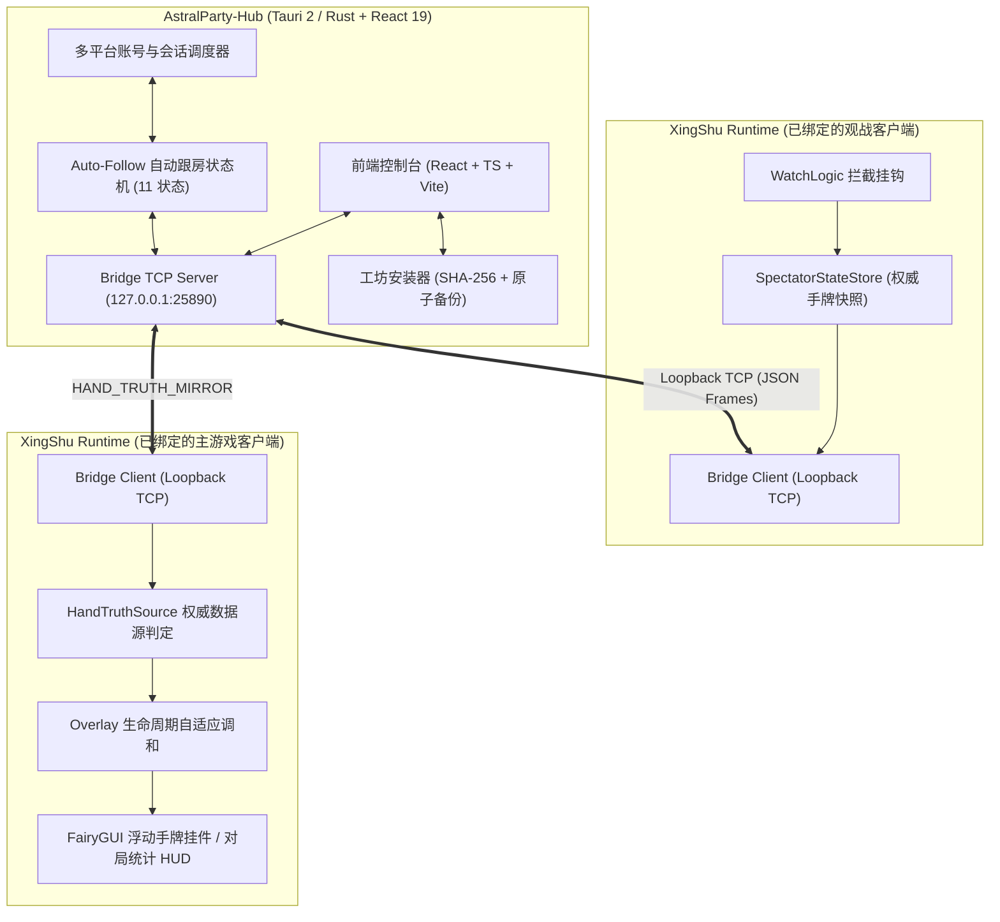

<h1 align="center">AstralParty-XingShu</h1>

<h3 align="center">感谢您选择 AstralParty-XingShu（星枢）！</h3>

<p align="center">
  <strong>反馈问题与建议：QQ 群 <code>540929823</code> &nbsp;|&nbsp; <a href="https://discord.gg/dxVS6ZF393">Discord</a></strong>
</p>

<p align="center">
  
</p>

<p align="center">
  回放复盘 · 手牌联动 · 模组工坊 · 离线图鉴 · 游戏内辅助
</p>

<p align="center">
  <a href="https://github.com/Breezecaresses/AstralParty-XingShu/releases"></a>
  
  
  
  
  <a href="LICENSE"></a>
</p>

<p align="center">
  <a href="https://github.com/Breezecaresses/AstralParty-XingShu/releases">下载最新版</a> ·
  <a href="https://astralparty-xingshu.lanxichaxu.cn/xingshu-hub/">在线网页版</a> ·
  <a href="docs/README.md">文档与验证记录</a> ·
  <a href="README.md">English</a> · <a href="README_CN.md">简体中文</a>
</p>

---

## 正式版本

[下载星枢 v0.1.3](https://github.com/Breezecaresses/AstralParty-XingShu/releases/tag/v0.1.3)，电脑端与安卓手机端同步适配《吉星派对》`3.3.0`（资源版本 `152`）。

| 平台 | 获取方式 | 说明 |
| --- | --- | --- |
| **Windows 桌面端** | `XingShu_Desktop_*.zip` | 包含星枢 Hub、`星枢安装助手.exe` 及 Steam 国服、TapTap 电脑版、哔哩哔哩、WeGame 四渠道插件；支持**模组工坊** SHA-256 校验与原子备份后一键安装/还原。 |
| **在线网页版** | [astralparty-xingshu.lanxichaxu.cn/xingshu-hub](https://astralparty-xingshu.lanxichaxu.cn/xingshu-hub/) | 免安装打开即用：支持玩家 UID 战绩查询、`.rep` / 对局编号回放深度分析、棋盘步进复盘、全量图鉴以及社区**模组 / 卡牌 / 皮肤工坊**下载与投稿。 |
| **安卓手机端** | `XingShu_Android_*.zip` / `.apk` | 含手机安装助手 APK、手动替换与官方还原文件，支持本机无线调试与同路径覆盖前备份整理。详见[手机安装说明](docs/guides/ANDROID_PHONE_INSTALL.md)。 |

> [!NOTE]
> 软件自更新不会自动替换游戏内插件。应用更新完成后，请正常退出游戏，再通过安装助手重装或校验游戏内运行时插件。详见[本次发布记录](docs/records/RELEASE_20261113_0.1.3.md)与[发布下载项](docs/guides/RELEASE_PACKAGING.md)。

---

## 项目简介

**AstralParty-XingShu（星枢）** 是面向《Astral Party》（吉星派对）的多端工作站、回放分析平台、模组工坊与游戏增强运行时套件：

1. **AstralParty-Hub（桌面控制台 & 网页版）**：基于 Tauri 2 + Rust + React 19 + TypeScript 构建。提供多平台账号隔离与自动跟房调度、对局 `.rep` 回放帧级复盘、实时棋盘格网还原、全角色静态表情/高清立绘/卡牌/筹码/地图攻略离线图鉴，以及社区**游戏内优化 Mod / 卡牌替换 / 角色皮肤工坊**。
2. **XingShu Runtime（游戏内 C# 运行时）**：注入游戏客户端的辅助模块，提供队友手牌悬浮窗、左侧防御与闪避建议、怪物技能冷却追踪、自由缩放选目标镜头以及确定性 FairyGUI 生命周期调和。

---

## 核心功能亮点

- **对局回放复盘与实时棋盘**：输入对局编号或导入本地 `.rep` 文件，即可查看逐轮伤害/星币趋势、打怪击杀金币统计、筹码三选一、前 6 轮代付意愿、可交互图表筛选、可排序详表以及逐事件步进棋盘拓扑。
- **游戏内 Mod / 卡牌 / 皮肤工坊**：集中收录优化 Mod、卡牌贴图替换、角色皮肤与语音特效包。网页版支持预览、筛选、下载及社区投稿审核；桌面版支持 SHA-256 校验与 `.xingshu-mods` 原子备份后一键安装与无损还原。
- **静态表情与全角色图鉴**：同步资源 `152` 完整资料，收录 38 条角色配置（36 已发布角色 + 2 条预更新槽位）、75 张卡牌、93 项筹码与 26 条地图配置；图鉴、对局、UID 查询与机器人战绩卡统一采用无重复随机静态表情头像，并在角色展示页完整保留竖版全身立绘与动态皮肤。
- **权威手牌联动与多渠道兼容**：在允许观战的合作局中保持同一账号登录 Hub（或配合独立观战端，详见[本机观战说明](AstralParty-Hub/docs/local-managed-watcher.md)），可在角色旁实时显示队友手牌。Steam 国服已实测四人真人合作局，TapTap、Bilibili 与 WeGame 已通过安装文件校验。

---

## 架构概览



---

## 核心技术机制

- **权威手牌真值 (`HandTruthSource`)**：手牌镜像仅经由本机 `127.0.0.1` 回环传递，严禁渲染伪造占位卡牌 (`CardId = -1`)，严格与对局英雄名单校验。
- **确定性挂件生命周期调和**：基于 10 类生命周期事件触发自适应两级轮询，解决过场与重连导致的 FairyGUI 挂件脱离问题。
- **11 状态自动跟房与多账号隔离**：精准分离主玩账号与观战账号会话，跨局自动清理状态、退出房间并重置指纹。
- **工坊与更新链路安全**：强制 HTTPS 与 RSA 签名/SHA-256 校验，上传 ZIP 严格拦截路径穿越、符号链接与可执行扩展名，安装前强制保存原版基线备份。

---

## 目录结构

```text
AstralParty-XingShu/
├── AstralParty-Hub/                      # Tauri 2 + React 19 桌面与网页控制台
│   ├── src/                              # 前端源码（回放分析、模组工坊、图鉴、账号）
│   ├── src-tauri/                        # Rust 后端（TCP 中继、工坊校验与原子安装）
│   └── public/                           # 静态图鉴资源与站点 SEO 文件
├── XingShu-Dev/                          # 游戏内 C# Unity 运行时模块
│   ├── src/XingShu.Runtime/              # 核心运行时、FairyGUI 挂件、F1 功能中心
│   └── tools/                            # 编译与一致性验证脚本
├── AndroidInstaller/                     # 安卓无线调试安装助手源码
├── tools/                                # 图鉴导出、打包脚本、更新器与导出测试
├── docs/                                 # 使用指南与历史验证记录
└── LICENSE                               # MIT 开源许可证
```

---

## 本地构建

> [!NOTE]
> 本仓库遵循合规开源原则，**不包含**任何游戏专有 DLL、原版商业资源包或敏感凭据。

### 1. AstralParty-Hub（桌面端与网页版）

- 环境要求：Node.js 18+、Rust & Cargo（最新 stable）、Visual Studio C++ 生成工具、Microsoft Edge WebView2。

```bash
cd AstralParty-Hub
npm ci

# 构建在线网页版静态产物
npm run build:web

# 构建 Tauri 桌面端程序（免安装包模式）
npm run tauri -- build --no-bundle
```

### 2. XingShu Runtime（C# 游戏插件）

- 环境要求：支持 C# 11 的 Visual Studio MSBuild（目标 `.NET Framework 4.0`）、Python 3.x、`XingShu-Dev/tools/lib` 下的 Mono.Cecil。
- 从合法拥有的客户端提取 `AstralParty.Runtime.dll` 放入 `XingShu-Dev/references/updated_20261019_verified/`（或指定 `AstralPartyRuntimePath`）。

```powershell
.\XingShu-Dev\tools\build.ps1 -Configuration Release
```

---

## 详细文档与验证记录

- [项目文档与验证记录](docs/README.md) — 文档总索引与历史发布验证记录
- [AUTO_FOLLOW_PROTOCOL.md](docs/guides/AUTO_FOLLOW_PROTOCOL.md) — 自动跟房本地 TCP 通信协议规范
- [AUTO_FOLLOW_STATE_MACHINE.md](docs/guides/AUTO_FOLLOW_STATE_MACHINE.md) — 自动跟房 11 状态机设计说明
- [HAND_TRUTH_SOURCE_ARCHITECTURE.md](docs/guides/HAND_TRUTH_SOURCE_ARCHITECTURE.md) — 手牌真值单源架构与防伪造设计
- [OVERLAY_LIFECYCLE_RECONCILIATION.md](docs/guides/OVERLAY_LIFECYCLE_RECONCILIATION.md) — 浮动挂件生命周期自适应调和规范
- [local-managed-watcher.md](AstralParty-Hub/docs/local-managed-watcher.md) — 本机托管观战说明
- [extension_channels.md](AstralParty-Hub/docs/specs/extension_channels.md) — 扩展包渠道声明与目录映射边界

---

## 免责声明与开源许可

1. 本项目仅供技术研究、本地测试、模组管理与社区交流学习使用。
2. 原游戏美术、文本、配置与音画资产版权均归原权利人所有，不随本项目代码许可证重新授权。
3. 请合理合规使用辅助功能并遵守游戏官方服务条款；开发者不对不当使用引发的账号风险承担责任。
4. 本仓库代码基于 [MIT 许可证](LICENSE) 开源。
